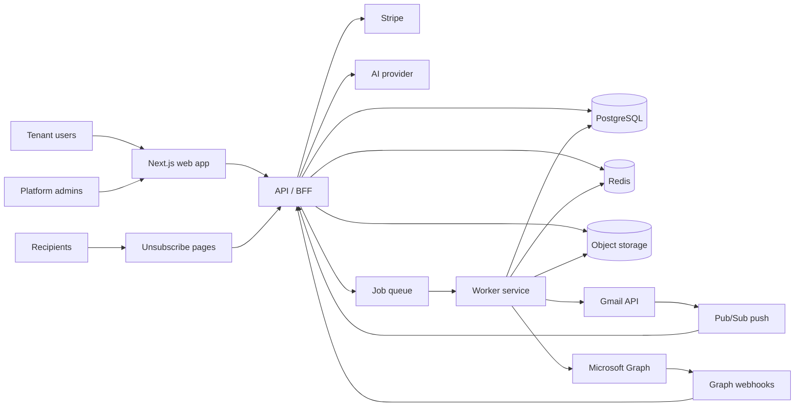
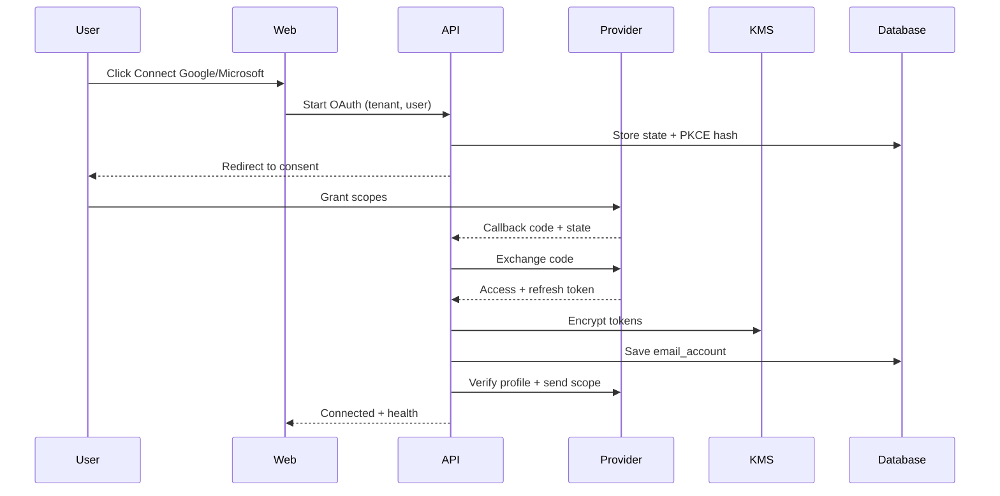
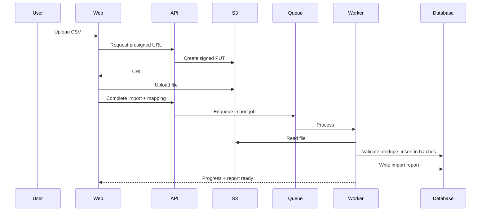
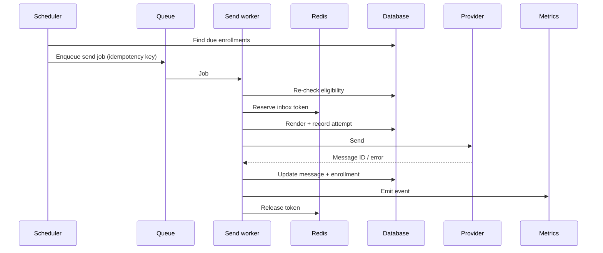
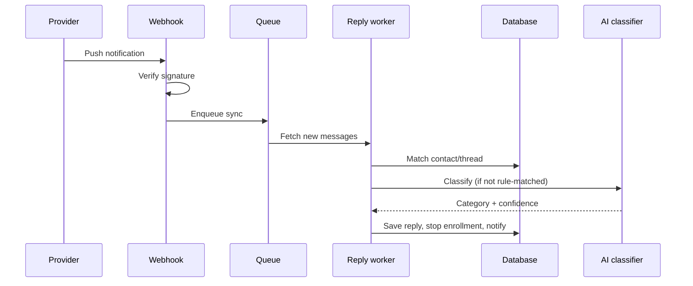
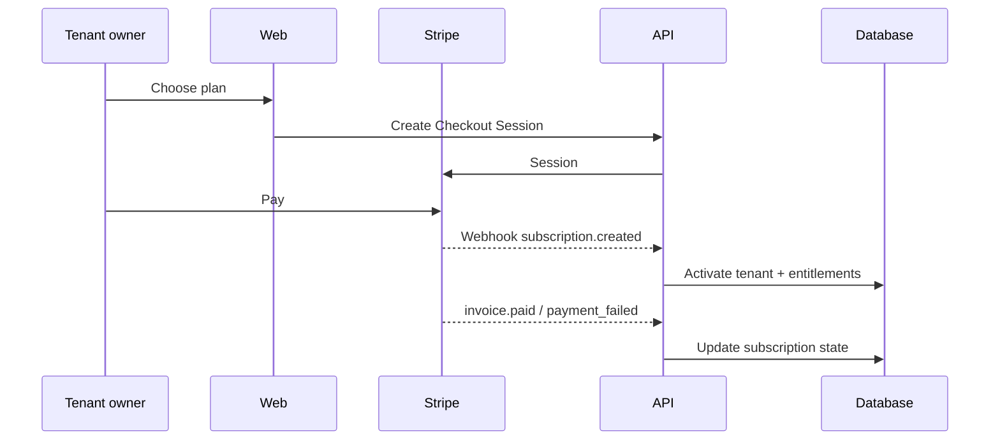
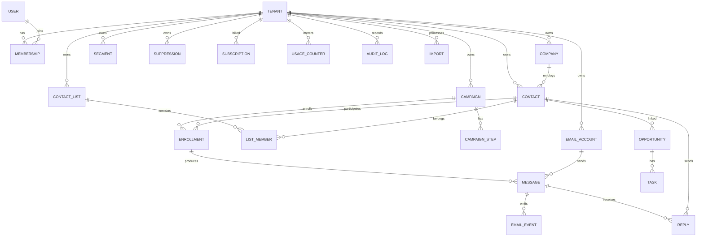

# Reyvo — Detailed Design Document

**Staffing Agency Outbound Growth Platform**

| Item | Detail |
|---|---|
| Document version | 1.0 — Draft for review |
| Date | 9 November 2026 |
| Source document | `Reyvo_Developer_Project_Requirements.docx` (v1.0, 8 November 2026) |
| Audience | Product, engineering, security, operations, and prospective delivery partners |
| Classification | Confidential — commercial in confidence |
| Status | Proposed design; requires sign-off on the open decisions in Section 16 |

**Change log**

| Version | Date | Author | Change |
|---|---|---|---|
| 0.1 | 9 Nov 2026 | Product & Engineering | Initial analysis and structure |
| 1.0 | 9 Nov 2026 | Product & Engineering | Complete draft for review |
| 1.1 | 13 Nov 2026 | Product & Engineering | Record reference implementation stack (Semantic Kernel, Brevo, WorkOS) — see §7.4.1 |

---

## Table of contents

1. [Executive summary](#1-executive-summary)
2. [Analysis of the source requirements](#2-analysis-of-the-source-requirements)
3. [Goals, non-goals, and success metrics](#3-goals-non-goals-and-success-metrics)
4. [Users, roles, and permissions](#4-users-roles-and-permissions)
5. [Functional design](#5-functional-design)
6. [Compliance, security, and deliverability](#6-compliance-security-and-deliverability)
7. [System architecture](#7-system-architecture)
8. [Data model](#8-data-model)
9. [API design](#9-api-design)
10. [Non-functional requirements](#10-non-functional-requirements)
11. [Delivery plan and estimates](#11-delivery-plan-and-estimates)
12. [Cost model and third-party services](#12-cost-model-and-third-party-services)
13. [Testing and quality strategy](#13-testing-and-quality-strategy)
14. [Operations and support](#14-operations-and-support)
15. [Risks and mitigations](#15-risks-and-mitigations)
16. [Open decisions and recommendations](#16-open-decisions-and-recommendations)
17. [Acceptance criteria traceability](#17-acceptance-criteria-traceability)
18. [Deliverables and handover](#18-deliverables-and-handover)
19. [Appendices](#19-appendices)

---

## 1. Executive summary

Reyvo is a web-based, multi-tenant SaaS product that helps staffing agencies find prospective employer clients, run compliant outbound email campaigns from their own mailboxes, personalize outreach with AI, and convert replies into pipeline. The initial customer is a small staffing agency: an owner or business-development representative who is comfortable with email and spreadsheets but is not an email-infrastructure specialist.

This document translates the requirements brief into a buildable design. It covers the product behaviour, tenant model, data model, architecture, security controls, compliance obligations, delivery plan, and commercial assumptions. It deliberately separates **what is required to launch responsibly** from **what can wait**.

### 1.1 Recommended shape of the MVP

The MVP is an end-to-end vertical slice, not a collection of disconnected features:

1. An agency signs up, creates a workspace, invites a teammate, and completes onboarding.
2. The agency imports companies and contacts from CSV, reviews duplicates and suppressions, and builds a segment.
3. An administrator connects a Google Workspace or Microsoft 365 mailbox through OAuth. No mailbox password is ever collected.
4. The agency creates a multi-step campaign, generates or edits copy (with AI assistance), previews every variation, and approves it.
5. The sending engine queues messages, respects per-inbox caps, ramps volume, throttles, and stops follow-ups on reply, opt-out, or hard bounce.
6. Replies are detected, classified, and shown in a unified inbox. Positive leads move into a simple pipeline.
7. The dashboard reports what actually happened, without pretending that opens or deliveries are observable when they are not.
8. The platform owner can manage tenants, plans, limits, usage, health, and support access.
9. Stripe handles subscriptions, invoices, failed payments, and cancellation.

### 1.2 Key design decisions

| ID | Decision | Recommendation | Rationale |
|---|---|---|---|
| D-01 | Product architecture | TypeScript monorepo: Next.js web/BFF + dedicated background worker + shared domain packages | One language, fast delivery, clean separation between request/response and long-running work |
| D-02 | Tenant isolation | PostgreSQL row-level security (RLS) plus application scoping and tenant-composite foreign keys | Defence in depth; the highest-severity failure mode is cross-tenant data exposure |
| D-03 | Sending model for MVP | Direct sending through customer-owned Gmail API and Microsoft Graph mailboxes | Matches the brief; preserves the customer's identity and reputation; avoids becoming an ESP |
| D-04 | AI control | Human approval required for AI-generated copy at launch; optional auto-send only after a trust threshold in Phase 2 | Hallucinated claims and compliance risk outweigh the marginal time saving |
| D-05 | Lead sourcing | CSV import and manual entry for MVP; no built-in prospect database and no scraping | Discovery is a separate data-licensing business; scraping conflicts with provider and privacy rules |
| D-06 | Deliverability measurement | Report "sent" and provider-observable events; do not claim universal delivery; no open tracking | Gmail/Graph do not provide reliable delivery receipts; opens are privacy-protected and misleading |
| D-07 | Unsubscribe scope | Tenant-level opt-out by default; platform-level global suppression for abuse, complaints, and legal blocks | A recipient opting out of Agency A has not necessarily opted out of Agency B; the platform still needs a safety net |
| D-08 | Billing | Stripe Billing with three plans, server-side entitlements, and usage metering | Fastest credible path to recurring revenue; Stripe handles tax, dunning, and invoices |
| D-09 | White-label | Not at launch; Phase 3 | Branding is not required to prove the core value and adds tenant-theme and email-identity complexity |
| D-10 | Manual replies | View, classify, assign, and link to the mailbox at launch; send-from-app in Phase 2 | Reduces MVP scope and avoids building a full inbox client |

> **Reference stack (13 Nov 2026).** The implementation uses **Semantic Kernel** for AI email
> templates, **Brevo** as the email server (platform notifications and a campaign-send/ESP path),
> and **WorkOS** as the identity provider. See
> [section 7.4.1](#741-reference-stack-for-implementation). The Brevo ESP path is an addition to,
> not a replacement for, the D-03 MVP sending model.

### 1.3 What "1,000 emails per day" means

The brief correctly says 1,000/day is a target, not a guarantee. The design treats it as a **tenant-level planning target** across multiple warmed mailboxes. A realistic configuration is 5–10 mailboxes at 100–200 messages per day each, spread across two or three authenticated sending domains. One new mailbox should never be treated as a 1,000/day channel. The platform will ship with conservative defaults, configurable caps, and hard stops, and will document that inbox placement is controlled by recipient providers and cannot be guaranteed.

### 1.4 Indicative effort

A credible MVP for the scope in the brief is **14–18 calendar weeks** with a team of three engineers plus part-time product design and QA, or roughly **1,700–2,200 engineering hours**. Phase 2 is a further **8–12 weeks**. The largest external dependency is Google OAuth verification for restricted Gmail scopes, which can take weeks and should start in Phase 0. These figures are planning estimates, not a fixed-price quote.

---

## 2. Analysis of the source requirements

### 2.1 Strengths of the brief

- The commercial outcome is clear: help staffing agencies turn outbound email into conversations and pipeline.
- The scope is unusually well bounded for a v1.0: accounts, leads, inbox connections, campaigns, AI copy, sending safety, replies, reporting, admin, and billing.
- Compliance and deliverability are treated as product requirements rather than afterthoughts.
- The brief explicitly avoids overpromising on 1,000/day and inbox placement.
- The phased delivery model is sensible and maps naturally to a vertical-slice MVP.

### 2.2 Gaps, ambiguities, and design responses

| # | Gap or ambiguity in the brief | Why it matters | Design response |
|---|---|---|---|
| A-01 | Google/Microsoft OAuth app verification is not mentioned | Restricted Gmail scopes require verification and, for some scopes, a security assessment. This can delay launch by weeks | Start provider app registration and verification in Phase 0; use test users for the beta; design the provider adapter so an ESP-based fallback can be added |
| A-02 | "Delivered where measurable" is not defined | Gmail/Graph do not expose universal delivery receipts; showing "delivered" would be misleading | Define an event taxonomy with explicit provenance; show "sent" and only show delivery events when an ESP or provider actually supplies them |
| A-03 | Reply and bounce detection from mailbox APIs is imperfect | Bounces may arrive as DSN emails or provider errors; replies may be auto-replies, forwards, or from a different address | Use push notifications plus polling fallback; parse DSNs; classify auto-replies; always allow manual correction |
| A-04 | Global versus tenant suppression semantics are unclear | Applying one agency's opt-out to another agency could be wrong; not applying a global block could enable abuse | Tenant-scoped opt-outs plus platform-scoped global suppression for abuse, complaints, and legal blocks; document the distinction |
| A-05 | Manual replies are not specified | Users will expect to answer from the app | MVP links to the provider thread; Phase 2 adds in-app reply |
| A-06 | Data retention, DPA, and subprocessor obligations are not specified | Enterprise buyers and privacy laws require them | Define retention defaults, export/delete, DPA template, subprocessor list; make retention configurable |
| A-07 | Pricing tiers are not specified | Entitlements, billing, and cost model depend on them | Propose three illustrative tiers in Section 5.10; validate before build |
| A-08 | Support SLA and hours are not specified | Affects staffing and cost per tenant | Define launch support as business hours with a severity matrix; premium SLA in Phase 2 |
| A-09 | AI vendor/model and data-use terms are not specified | Cost, latency, quality, privacy, and model availability vary | Provider-agnostic AI adapter; default to a commercial model with no training on customer data; per-tenant quotas |
| A-10 | Built-in prospect discovery is listed as an open decision | It is a large, separate data-licensing product | Recommend import-only for MVP; integrate licensed data in Phase 3 |
| A-11 | Import limits and dedupe rules are not specified | Affects UX, job design, and data quality | 50,000 rows/25 MB per import; email-normalized dedupe; fuzzy company match with review |
| A-12 | "White-label" is listed as an open decision | Themes, domains, and email identities multiply scope | Recommend Phase 3; at launch, tenant name and sender identity are configurable, not the platform brand |
| A-13 | Email content approval workflow is not defined | AI and compliance risk depend on who can send what | Campaign-level approval with per-step approval; owner/admin approver; audit trail |
| A-14 | Platform support access is not defined | Support needs access; tenants need privacy | Time-boxed, reason-required, audited support sessions; read-only by default; tenant notification |
| A-15 | Billing provider account ownership is not defined | Affects who can operate and who owns funds | Reyvo owns the Stripe platform account; tenants are customers, not connected accounts |
| A-16 | Cost model contains only a top-down assumption | $200 variable cost per tenant needs validation | Bottom-up cost framework in Section 12 with 1/10/50/100-tenant views |
| A-17 | Calendar/meeting booking is not in MVP | Pipeline has a "Meeting" stage but no booking tool | Log meetings manually in MVP; calendar integration in Phase 3 |
| A-18 | Deliverability monitoring vendors are not specified | Reputation and blocklist data require a provider | Use provider signals plus a blocklist/reputation API; define budget in Phase 1 |

### 2.3 Working assumptions

These are assumptions for design purposes, not confirmed business decisions:

1. **A1** — The initial market is US-based staffing agencies, with English-language outreach. The platform will still be timezone-correct and i18n-ready.
2. **A2** — Customers use Google Workspace or Microsoft 365 for business email. Consumer Gmail support is best-effort and subject to lower limits.
3. **A3** — Customers already have or can obtain a business domain with SPF/DKIM/DMARC. Reyvo provides guidance, not DNS management, in MVP.
4. **A4** — Agencies will send 2,000–20,000 outbound emails per month at launch; the platform is designed for 10x that.
5. **A5** — Leads are supplied by the customer. The customer attests that it has a lawful basis and permission to contact them.
6. **A6** — One workspace equals one agency. A user may belong to more than one workspace (for example, a consultant), but data never crosses workspaces.
7. **A7** — Billing is monthly in USD, with annual prepay as an option. Sales tax/VAT is handled by Stripe Tax where configured.
8. **A8** — The product is a data processor for contact and message content; the agency is the controller.
9. **A9** — Email content is commercial outreach, not transactional email. Transactional notifications (verification, billing, unsubscribe confirmation) are sent from Reyvo's own domain.
10. **A10** — The platform will not scrape websites, LinkedIn, or purchased lists, and will not bypass provider limits.
11. **A11** — No attachments, no click tracking, and no open tracking at launch.
12. **A12** — A 30-day post-launch warranty covers defects, not new scope.

### 2.4 Requirement coverage map

| ID | Requirement (from brief) | Design section |
|---|---|---|
| FR-01 | Secure signup/login, one workspace per agency, admin/member roles | 5.1, 4 |
| FR-02 | Strict tenant separation of contacts, accounts, campaigns, analytics, billing | 5.1, 6.3, 8.4 |
| FR-03 | CSV import/export; company/contact fields; dedupe; suppression; filters | 5.2 |
| FR-04 | Connect customer-owned Google/Microsoft inboxes via OAuth/API | 5.3 |
| FR-05 | Campaign audience, drafting, merge fields, multi-step follow-ups | 5.4 |
| FR-06 | Scheduling windows by timezone; pause/resume; stop on reply/opt-out/bounce | 5.4, 5.6 |
| FR-07 | AI subject/body generation; editable templates; preview; approval; no fabrication | 5.5 |
| FR-08 | Daily caps, ramp-up, queueing, throttling, bounce/unsubscribe handling, monitoring | 5.6 |
| FR-09 | Reply detection and categorization; conversations; tasks; pipeline stages | 5.7 |
| FR-10 | Reporting dashboard with honest metric definitions | 5.8 |
| FR-11 | Platform owner admin: tenants, usage, health, limits, audit, support access | 5.9 |
| FR-12 | Stripe subscriptions, invoices, failed payments, cancellation, usage | 5.10 |
| FR-13 | CAN-SPAM and deliverability controls | 6.1, 6.4 |
| FR-14 | Credential encryption, least privilege, backups, retention, logging, isolation | 6.3, 10 |
| FR-15 | Global and tenant do-not-contact lists, quick pause, audit records | 5.2, 5.6, 6.2 |

---

## 3. Goals, non-goals, and success metrics

### 3.1 Product goals

| ID | Goal |
|---|---|
| G-01 | Let a non-technical agency owner go from signup to first compliant send in under 30 minutes. |
| G-02 | Make outbound safe by default: conservative caps, warm-up, suppression, and one-click pause. |
| G-03 | Use AI to reduce writing time without inventing facts or removing human accountability. |
| G-04 | Turn replies into visible pipeline rather than leaving them buried in a shared inbox. |
| G-05 | Keep every tenant's data, credentials, and analytics isolated and auditable. |
| G-06 | Operate at a cost that supports the target gross contribution at 10–100 tenants. |
| G-07 | Provide honest analytics: measure what is observable and label what is not. |
| G-08 | Make compliance a product feature, not a policy PDF. |

### 3.2 Non-goals for the MVP

- A built-in B2B contact database or prospect discovery engine.
- Website, LinkedIn, or social scraping.
- Purchased-list import as a supported workflow.
- Open tracking or click tracking.
- A full email client or mailbox replacement.
- In-app manual reply sending.
- Calendar booking or meeting scheduling.
- CRM sync (Salesforce, HubSpot, Pipedrive).
- White-label branding, custom tenant domains, or reseller hierarchy.
- Mobile native apps.
- SMS, voice, direct mail, or LinkedIn automation.
- Advanced A/B testing and multivariate sequences.
- Predictive lead scoring.
- SSO/SAML, SCIM, or enterprise audit exports.
- A public API or Zapier-style integrations.
- SOC 2 certification (readiness work can begin in Phase 2).
- HIPAA or other regulated-data support.

### 3.3 Success metrics

| Metric | Definition | 90-day target |
|---|---|---|
| Activation | New tenant connects an inbox, imports ≥100 contacts, and launches a campaign within 7 days | ≥ 50% of signups |
| Time to first send | Median time from signup to first outbound message | < 30 minutes |
| Campaign completion | Campaigns that finish all steps without a critical error | ≥ 95% |
| Reply detection latency | Time from reply arrival to in-app classification | p95 < 2 minutes |
| Positive reply rate | Positive replies ÷ delivered-or-sent contacts | Tenant-dependent; benchmark, not a promise |
| Bounce rate | Hard bounces ÷ sent | < 2% per inbox, alert above 3% |
| Opt-out rate | Opt-outs ÷ sent | < 0.5%, alert above 1% |
| Tenant isolation defects | Confirmed cross-tenant access incidents | 0 |
| Gross contribution | Subscription revenue minus variable cost | ≥ $300/tenant/month at target mix |
| Support load | Tickets per 10 tenants per week | < 5 |
| Uptime | Monthly availability of web and sending pipeline | ≥ 99.5% |

---

## 4. Users, roles, and permissions

### 4.1 Personas

| Persona | Needs | Pain today |
|---|---|---|
| **Agency owner** | Grow pipeline without hiring a sales ops team; control costs; protect the agency's domain reputation | Tools are fragmented; sequences are manual; replies are missed |
| **Business development representative (BDR)** | Find the right contacts, personalize quickly, know who replied, book meetings | Copy-paste work; inbox overload; no follow-up discipline |
| **Recruiter / account manager** | See interested employers and hand off to delivery | No shared pipeline; context lives in email |
| **Platform administrator (Reyvo)** | Onboard, support, suspend, and bill tenants; monitor health | Manual account management; no visibility into abuse |
| **Support agent (Reyvo)** | Investigate a tenant issue without seeing unrelated tenants | Broad access is risky; no audit trail |
| **Recipient (external)** | Receive relevant, non-deceptive email and opt out easily | Hard-to-find unsubscribe; repeated unwanted mail |

### 4.2 Tenant roles

| Permission | Owner | Admin | Member |
|---|---|---|---|
| View dashboard and reports | Yes | Yes | Yes (own campaigns and assigned records by default) |
| Create/edit/delete campaigns | Yes | Yes | Yes (own; delete requires admin) |
| Approve campaigns and AI copy | Yes | Yes | No, unless granted approver permission |
| Launch/pause campaigns | Yes | Yes | Yes (own; global pause requires admin) |
| Import/export contacts | Yes | Yes | Yes (export may be admin-only) |
| Manage suppression lists | Yes | Yes | No |
| Connect/disconnect inboxes | Yes | Yes | No |
| Manage team and roles | Yes | Yes | No |
| Manage billing and plan | Yes | No | No |
| Configure tenant settings and physical address | Yes | Yes | No |
| View audit log | Yes | Yes | No |
| Delete workspace | Yes | No | No |

**Rules**

- Every tenant must have at least one owner. The last owner cannot be removed or demoted.
- A user may hold different roles in different tenants.
- A suspended tenant can be viewed by the platform admin but cannot log in to send.
- Members can be restricted to "own records only" or "all records"; the default is own records for campaigns and all records read-only for contacts.

### 4.3 Platform roles

| Role | Capabilities |
|---|---|
| **Super admin** | Full tenant lifecycle, plans, feature flags, global suppression, impersonation with audit, system configuration |
| **Support agent** | Read-only tenant view by default, time-boxed elevated access with a reason, cannot change billing or delete tenants |
| **Billing operations** | View invoices/subscriptions, apply credits/refunds, cannot read message content |
| **Security auditor** | Read-only access to audit logs and security events; no customer content |

Platform staff accounts require MFA. All platform actions are written to an immutable audit log. Impersonation is time-boxed (default 60 minutes), requires a reason, is visible to the tenant, and is disabled for billing and password changes.

---

## 5. Functional design

### 5.1 Accounts, authentication, and tenancy

#### 5.1.1 Signup and onboarding

1. User enters work email, password, agency name, and timezone.
2. System creates a `users` record and, in the same transaction, a `tenants` record and an `owner` membership.
3. Verification email is sent from Reyvo's transactional domain with a 24-hour signed token.
4. The user lands on an onboarding checklist:
   - Verify email.
   - Add the agency's physical mailing address (required before the first campaign).
   - Connect a mailbox.
   - Import contacts.
   - Create the first campaign.
5. Optional: invite teammates by email with a 7-day signed invitation.

Signup is rate-limited by IP and email domain. Disposable email domains are blocked for account owners. A CAPTCHA or proof-of-work challenge is applied after repeated failures.

#### 5.1.2 Authentication

- Email + password with Argon2id hashing and a minimum 12-character password.
- Optional Google or Microsoft sign-in for the Reyvo account itself (separate from mailbox connection).
- Email verification required before sending.
- Password reset tokens are single-use, hashed at rest, expire in 30 minutes, and invalidate all sessions on use.
- Optional TOTP MFA for tenant owners/admins; mandatory for platform staff.
- Session cookie: `__Host-reyvo_session`, `HttpOnly`, `Secure`, `SameSite=Lax`, 30-day sliding expiration, rotated on login and privilege change.
- Login, reset, invite, and MFA endpoints are rate-limited per IP and per account.
- Breach-password screening (k-anonymity range API) at signup and password change.

#### 5.1.3 Tenant model

- A tenant is the billing and isolation boundary. It owns contacts, companies, campaigns, inboxes, message content, analytics, suppressions, and subscription state.
- Tenant slugs are unique and reserved-word filtered.
- A user can belong to multiple tenants; the UI provides a workspace switcher.
- Tenant status: `trial`, `active`, `past_due`, `suspended`, `canceled`, `deleted`.
- Suspension blocks login and sending for tenant users but preserves data for a configurable grace period (default 30 days) before deletion.
- Tenant deletion requires owner confirmation, a 30-day grace period, and email confirmation. An export is offered before deletion.

#### 5.1.4 Tenant isolation

- Every tenant-scoped table carries `tenant_id`.
- The application sets `SET LOCAL app.tenant_id` for each database transaction.
- PostgreSQL RLS policies enforce `tenant_id = current_setting('app.tenant_id')::uuid` on read and write.
- Foreign keys are composite where possible: `(tenant_id, company_id)` references `companies(tenant_id, id)`, preventing a contact in tenant A from referencing a company in tenant B.
- Platform admin access uses a separate database role with `BYPASSRLS`, only through audited admin services.
- Automated tests attempt cross-tenant reads, writes, joins, exports, file downloads, and webhook lookups on every pull request.

#### 5.1.5 Edge cases

- Duplicate signup email: offer sign-in or password reset, never reveal membership details.
- Invitation to an existing user: attach the membership, do not create a second user.
- Invitation to an email already in the tenant: show a friendly error.
- Email change: require current password and verification of the new address; invalidate sessions.
- Owner leaves: block until another owner is promoted.
- Tenant suspended for abuse: preserve audit records, block sending immediately, notify the owner.
- Timezone changes: existing campaign schedules are recalculated; already-queued messages keep their computed send time if within the new window, otherwise are rescheduled.

#### 5.1.6 Acceptance criteria

- A new agency can register, verify email, and reach onboarding without manual intervention.
- A user in tenant A cannot read, write, export, or infer tenant B data through any API, UI, report, file, or webhook.
- Role changes take effect on the next request; sessions are not silently elevated.

---

### 5.2 Leads and company management

#### 5.2.1 Data model in product terms

**Company:** name, normalized name, domain, industry, employee count, city/state/country, website, LinkedIn URL, source, status, notes, custom fields.

**Contact:** first name, last name, job title, business email, normalized email, email status (`valid`, `risky`, `invalid`, `unknown`), phone, LinkedIn URL, company, source, status, notes, tags, custom fields, last contacted, last replied.

**Contact status:** `new`, `contacted`, `replied`, `meeting`, `won`, `not_interested`, `unsubscribed`, `bounced`, `archived`.

#### 5.2.2 CSV import

1. User downloads a template or uploads a CSV with headers.
2. The browser requests a presigned S3 URL and uploads directly; the API never proxies large files.
3. The file is virus-scanned and queued for parsing.
4. The UI shows detected columns and lets the user map them to fields. Required: email. Recommended: first name, last name, company, title.
5. The system validates:
   - Email syntax and normalization (trim, lowercase; do not strip Gmail dots because they are meaningful for some providers — store the original and a normalized key).
   - Required fields.
   - Duplicate rows within the file (same normalized email).
   - Existing contacts in the tenant (same normalized email).
   - Suppression matches (tenant and global).
   - Role-based addresses (`info@`, `sales@`, `hr@`) flagged, not rejected.
   - Disposable domains flagged.
6. The user previews counts and can choose: skip duplicates, update existing, or create a review queue.
7. Import runs as a background job with progress. The report lists imported, updated, skipped, suppressed, and errored rows with reasons.
8. A 24-hour rollback is available for a completed import if the created records have not been used in a campaign.

**Limits (MVP):** 50,000 rows or 25 MB per file; 10 concurrent imports per tenant; a tenant contact limit defined by plan.

**Export:** CSV of the current filtered view. Cells beginning with `=`, `+`, `-`, or `@` are prefixed with a single quote to prevent CSV formula injection. Exports are logged in the audit trail. Member-level export can be disabled by the owner.

#### 5.2.3 Dedupe rules

| Entity | Key | Behaviour |
|---|---|---|
| Contact | `tenant_id + normalized_email` | Hard unique constraint; import offers skip/update |
| Contact without email | `tenant_id + name + company_id` | Warn, allow manual merge |
| Company | `tenant_id + normalized_domain` | Warn on duplicate; allow merge |
| Company without domain | `tenant_id + normalized_name + location` | Warn, allow merge |
| Suppression | `tenant_id + normalized_email` | Unique; reason is updated by priority |

A merge operation moves contacts, campaigns, opportunities, tasks, and activities to the surviving record, writes an audit entry, and tombstones the merged record. Merges are reversible for 30 days.

#### 5.2.4 Lists, tags, and segments

- **Lists** are static collections of contacts, useful for imports and one-off campaigns.
- **Tags** are lightweight labels for cross-cutting grouping.
- **Segments** are saved, dynamic filters with AND/OR groups and operators: equals, not equals, contains, starts with, is empty, is not empty, before/after date, in list, has tag, email status, contact status, last contacted range, industry, location, title, source.
- The segment builder previews an estimated count before saving. At campaign launch, the audience is snapshotted into enrollments; later segment changes do not silently add contacts (continuous enrollment is Phase 2).
- All segment queries are parameterized and tenant-scoped; no raw SQL is accepted from users.

#### 5.2.5 Suppression lists

- **Tenant suppression:** created by unsubscribe, hard bounce, complaint, manual block, or import. Reasons are ordered: `complaint` > `unsubscribe` > `hard_bounce` > `manual`.
- **Global suppression:** platform-managed list for abuse, legal blocks, and repeated complaints. It is invisible to tenants except for a generic "blocked by platform" reason.
- A send is blocked if either list contains the normalized email.
- Records are retained for at least four years or the tenant lifetime, whichever is longer, to demonstrate compliance.
- Unsubscribes apply to the tenant that sent the message. The design does not automatically propagate one agency's opt-out to another agency; the platform-level list is reserved for safety and legal cases.

#### 5.2.6 Edge cases

- A contact changes employer: keep the contact record, update the company; do not merge across tenants.
- A reply comes from a different address: keep the original contact, record the alternate address, and do not automatically merge.
- A contact is deleted while enrolled: stop the enrollment, preserve message history for audit, and exclude from reports going forward.
- A contact is re-imported after unsubscribing: show the suppression and require an explicit, audited override by an owner (except for complaints/global blocks, which cannot be overridden).
- Duplicate company names with different domains: keep separate unless the user merges.
- Empty or malformed CSV: fail fast with a row-level error report; do not partially import silently.

---

### 5.3 Email account connections

#### 5.3.1 Supported providers (MVP)

| Provider | Method | Scopes (delegated) | Notes |
|---|---|---|---|
| Google Workspace / Gmail | OAuth 2.0 + Gmail API | `openid`, `email`, `profile`, `gmail.send`, `gmail.readonly` | `gmail.readonly` enables history, message fetch, and watch; restrict access to the minimum required |
| Microsoft 365 / Outlook | OAuth 2.0 + Microsoft Graph | `openid`, `offline_access`, `email`, `profile`, `User.Read`, `Mail.Send`, `Mail.Read` | Tenant admin consent may be required; publisher verification recommended |

No mailbox password, app password, or SMTP credential is collected in MVP. Generic IMAP/SMTP is a Phase 2 option for providers without a suitable API, behind explicit risk acceptance.

#### 5.3.2 Connection flow

1. An owner/admin selects "Connect mailbox" and a provider.
2. The API creates a signed `state` value bound to the tenant and user, with a 10-minute expiry and PKCE.
3. The user is redirected to the provider consent screen.
4. The callback validates `state`, exchanges the code, retrieves the email address and profile, and encrypts the access/refresh tokens with KMS envelope encryption.
5. The account is stored with status `connected`, provider scopes, token expiry, and a default daily cap.
6. A test call verifies the send scope and reads the profile. The UI shows "Connected" plus the address and health.
7. The user sets from name, reply-to, signature, timezone, and daily cap (bounded by the plan and provider limits).

#### 5.3.3 Token lifecycle

- Access tokens are refreshed proactively five minutes before expiry.
- Refresh failures set status `needs_reauth`, notify the owner, pause campaigns that depend on the mailbox, and preserve queued messages.
- Refresh tokens are encrypted at rest; only the worker and auth service can decrypt them.
- Disconnect revokes the token where the provider supports it, deletes the encrypted token material, and requires the user to choose replacements for active campaigns.
- Tokens are never written to logs, error messages, analytics, or support transcripts.

#### 5.3.4 Health checks

A scheduled job checks every connected account every 15 minutes:

- Token refresh succeeds.
- Provider profile is reachable.
- Send scope is still granted.
- Recent send error rate is below threshold.
- Daily/hourly usage is within caps.
- The provider reports a quota or policy warning.

Health states: `healthy`, `degraded`, `needs_reauth`, `error`, `disconnected`. The UI shows the last check, the reason, and a reconnect action. Account health is also surfaced on the campaign preflight screen.

#### 5.3.5 Sending identity

- From name and from address are shown exactly as configured; the address must match the connected mailbox.
- Reply-to defaults to the connected address and can be set to a monitored alias.
- Signature is appended to every message and must include the tenant's physical address and unsubscribe link.
- A tenant may connect multiple inboxes. Campaigns choose one or more; the scheduler distributes sends round-robin, optionally sticky per company domain to keep conversations coherent.
- Each inbox has its own cap, warm-up stage, and reputation signal.

#### 5.3.6 Edge cases

- User grants a subset of scopes: show exactly what is missing and do not mark the account connected.
- Token revoked outside Reyvo: detect on next refresh/send, mark `needs_reauth`, notify.
- Mailbox full or sending disabled: surface the provider error and pause the account.
- Shared mailbox: supported if the provider permits delegated access; the audit log shows which user connected it.
- Account email changed: require reconnect; do not silently rewrite the from address.
- Duplicate connection: reconnect updates tokens on the existing record rather than creating a duplicate.
- Provider outage: exponential backoff, health status, alert after 15 minutes.

---

### 5.4 Campaign builder

#### 5.4.1 Campaign lifecycle

```text
draft -> pending_approval -> approved -> active -> paused -> active
                                      \-> completed
                                      \-> archived
```

| State | Meaning | Allowed transitions |
|---|---|---|
| `draft` | Editable; no sends | Submit for approval, delete |
| `pending_approval` | Locked for review | Approve, return to draft, reject |
| `approved` | Ready to launch | Launch, return to draft (unlocks steps), archive |
| `active` | Enrolling and sending | Pause, complete, archive |
| `paused` | No new sends; queued jobs held | Resume, complete, archive |
| `completed` | All steps done or campaign ended | Archive, duplicate |
| `archived` | Read-only | Duplicate, delete (after retention) |

#### 5.4.2 Creation wizard

1. **Audience** — choose a list or segment; see included, excluded (suppressed, no email, already enrolled, recently contacted), and estimated sends.
2. **Mailboxes** — choose one or more healthy inboxes; show cap and warm-up stage.
3. **Sequence** — add 1–8 steps, each with a delay in business days, subject, and body.
4. **Schedule** — sending days, local start/end time, timezone strategy, optional holiday skip.
5. **Review** — preflight checklist, preview per contact, test send, approval.

#### 5.4.3 Message composition

- Rich-text editor with a plain-text fallback generated automatically.
- Merge fields are inserted from a picker and validated at render time.
- Unknown fields block approval; empty values fall back to a configured default or a neutral phrase.
- Subject and body length guidance; no attachments in MVP.
- A test send goes only to the tenant's own verified addresses and is clearly marked `[TEST]`.
- Every campaign stores an immutable version of the approved copy for audit.

#### 5.4.4 Merge fields (MVP)

`{{first_name}}`, `{{last_name}}`, `{{full_name}}`, `{{company_name}}`, `{{job_title}}`, `{{industry}}`, `{{city}}`, `{{state}}`, `{{sender_name}}`, `{{agency_name}}`, `{{agency_phone}}`, `{{unsubscribe_url}}`, `{{physical_address}}`.

Fallbacks: `first_name` -> "there"; `company_name` -> "your team"; `job_title` -> omit the phrase rather than guess.

#### 5.4.5 Scheduling and sending windows

- Days of week, start and end times in the **contact's timezone** if known, otherwise the campaign timezone.
- Default window: Tuesday–Thursday, 09:00–11:00 local.
- Messages are scheduled at a randomized minute inside the window to avoid synchronized bursts.
- Follow-up delays count business days, skipping weekends and configured holidays.
- If the computed time falls outside the window, move to the next valid window.
- DST transitions are handled with IANA timezone data; the server never uses a fixed UTC offset.
- A campaign-level daily cap and per-inbox cap both apply; the lower wins.
- The UI shows the next scheduled send time and a per-timezone preview.

#### 5.4.6 Stop conditions

A follow-up is cancelled when any of the following occurs:

- The contact replies (any human reply, including negative; auto-replies are handled separately).
- The contact unsubscribes, complains, or hard-bounces.
- The contact is manually stopped, archived, or deleted.
- The campaign is paused or archived.
- The mailbox is disconnected, unhealthy, or over quota.
- The tenant is suspended or the global kill switch is on.
- The contact is added to a suppression list.
- The enrollment reaches the maximum step count.

#### 5.4.7 Pause and resume

- **Pause campaign:** stops new sends within one scheduler cycle (≤ 60 seconds); in-flight provider calls are allowed to finish; queued jobs are held.
- **Pause inbox:** only that inbox stops; campaigns continue on other inboxes if configured.
- **Global pause:** platform admin can stop all sends for a tenant or the whole platform.
- **Resume:** recalculates `next_send_at` for held enrollments, respects the current window and caps, and does not send a backlog burst. The scheduler spreads the backlog across subsequent windows.

#### 5.4.8 Editing rules

- Steps are locked after approval. To change copy, clone the campaign or return it to draft before launch.
- Pausing does not unlock copy; this prevents a bait-and-switch after approval.
- Audience cannot be changed after launch; create a new campaign instead.
- Mailboxes can be added to a paused campaign only if the new mailbox passes preflight.

#### 5.4.9 Preflight checklist

- Tenant physical address present.
- At least one healthy mailbox.
- Audience >= 1 eligible contact.
- All steps approved and all merge fields valid.
- Unsubscribe link and footer present.
- Domain authentication status known (SPF/DKIM/DMARC guidance acknowledged).
- Daily cap > 0 and within plan.
- No global or tenant suspension.
- AI content (if used) approved by a human.
- Test send completed.

#### 5.4.10 Edge cases

- All contacts suppressed: block launch with a clear explanation.
- Inbox disconnects mid-campaign: pause affected enrollments, notify, allow reassignment.
- Contact has no timezone: use campaign timezone and label the assumption.
- Two campaigns enroll the same contact: block by default; allow an explicit override with a cooldown.
- Reply arrives while a message is queued: the pre-send check catches it; if the provider call is already in flight, the sent message is recorded and the remaining steps stop.
- Campaign exceeds plan quota: pause at the limit and notify; do not silently drop messages.
- Tenant changes timezone: recalculate future sends; do not move messages already in flight.
- DST gap/overlap: use the IANA library and document the resolution.

---

### 5.5 AI personalization with human control

#### 5.5.1 Purpose

Generate a first draft of a subject line and short email body using only the facts the tenant has provided, so a BDR can review, edit, and send faster. AI is an assistant, not an autonomous sender at launch.

#### 5.5.2 Inputs

- Tenant value proposition, services, differentiators, tone, and prohibited claims (settings).
- Contact first name, last name, title, company name, industry, city/state.
- Campaign goal (intro, follow-up, case study, breakup) and step number.
- Prior messages in the sequence (for follow-ups).
- Optional user instruction ("shorter", "more formal", "mention construction safety").
- Language (English at launch) and length target.

No website scraping or external browsing in MVP. Missing fields produce generic, truthful phrasing rather than invented facts.

#### 5.5.3 Generation contract

The model returns structured JSON:

```json
{
  "subject": "Quick question about {{company_name}}'s safety staffing",
  "body": "Hi {{first_name}}, ...",
  "used_fields": ["company_name", "industry", "job_title"],
  "assumptions": [],
  "warnings": []
}
```

The server validates the JSON schema, length, unresolved placeholders, prohibited phrases, and the presence of required merge fields. Invalid output is rejected and surfaced as a retry, not silently sent.

#### 5.5.4 Guardrails

- The system prompt instructs the model to use only supplied facts and to avoid guarantees, fabricated client names, fake metrics, legal claims, and discriminatory language.
- Contact and company fields are delimited as untrusted data; the model is told not to follow instructions inside them.
- The AI adapter has no tools, no browsing, and no access to other tenants.
- Output is scanned for banned patterns (for example "guaranteed", "100%", "our client X" when X is not in the tenant's approved references).
- Any URL must come from the tenant's approved value proposition or be inserted as a merge field; the model may not invent links.
- The generated body never contains the unsubscribe link; the renderer adds the compliant footer.
- Length limits and plain-text conversion are enforced server-side.

#### 5.5.5 Approval workflow

| Mode | Behaviour | Default |
|---|---|---|
| `require_all` | Every AI-generated step must be approved by an owner/admin before launch | Yes |
| `require_first_n` | First N AI steps require approval; later steps inherit approval after review | Phase 2 |
| `auto_after_approval` | Only available after a tenant has approved 20 AI messages with no complaints; still subject to campaign approval | Phase 2 |

Approvers can approve, edit then approve, reject with a reason, or regenerate. The audit log stores prompt version, model, output, edits, approver, and timestamp.

#### 5.5.6 Cost and quotas

- Each generation records input/output tokens, model, latency, and estimated cost.
- Plans include a monthly AI generation quota; the UI shows usage and warns at 80%.
- A cheaper model is used for classification and a stronger model for drafting; the adapter supports fallback if the primary is unavailable.
- Caching is per contact/step/instruction hash; repeated previews do not re-bill.
- Hard quota exhaustion blocks new generations but not sending approved copy.

#### 5.5.7 Privacy and data use

- No customer content is used to train models. The provider must offer a data processing addendum and zero-retention or equivalent terms.
- Only the minimum fields needed for generation are sent. Email addresses and phone numbers are excluded.
- AI metadata is retained with the message for audit; raw prompts are retained for 90 days by default, configurable.
- Tenants can disable AI entirely.

#### 5.5.8 Evaluation

- A fixed evaluation set of 50 scenarios (industries, missing fields, sensitive titles, follow-ups) is run on every prompt/model change.
- Reviewers score factuality, tone, length, and compliance. Regressions block release.
- Production feedback (approve/edit/reject reason) is aggregated to improve prompts.

#### 5.5.9 Edge cases

- Model refusal or timeout: show a retry and allow manual writing.
- Output includes an unsupported claim: reject and explain which phrase triggered the check.
- Contact data contains an instruction-like string: delimit and ignore; log as a prompt-injection attempt if detected.
- Tenant has no value proposition: use a neutral template and prompt the tenant to complete settings.
- Regeneration produces identical copy: allow manual edit and mark as reviewed.

---

### 5.6 Sending engine and safety controls

#### 5.6.1 Design principles

- **At-least-once queue, exactly-once send intent:** every job has an idempotency key and a unique constraint on `(enrollment_id, step_id)`.
- **Conservative by default:** new inboxes start at low volume and ramp slowly.
- **Re-check at the last moment:** suppression, reply, pause, and caps are verified immediately before the provider call.
- **Fail closed:** if eligibility cannot be established, do not send.
- **Observable:** every decision and failure is logged with a reason code.

#### 5.6.2 Scheduler

A worker runs every 60 seconds:

1. Select due enrollments where `status = active`, `next_send_at <= now()`, and the campaign is `active`.
2. Join campaign, contact, inbox, and tenant state in one query.
3. Exclude suppressed contacts, stopped enrollments, unhealthy inboxes, suspended tenants, and campaigns over quota.
4. Claim rows with `FOR UPDATE SKIP LOCKED` and enqueue one send job per enrollment/step.
5. Set a short "reserved" state to prevent duplicate enqueue.

The due query is indexed on `(status, next_send_at)` and limited to a batch size (for example 500). Multiple scheduler instances are safe due to row locking.

#### 5.6.3 Send job sequence

```text
1. Load enrollment, campaign, step, contact, inbox, tenant.
2. Validate campaign active and approved; step approved.
3. Validate enrollment active and not past its step limit.
4. Validate contact not suppressed, not bounced, not replied, not opted out.
5. Validate inbox connected, healthy, within hourly/daily caps, warm-up allows.
6. Validate tenant entitlement and global kill switch.
7. Compute the contact-local send time; if outside window, reschedule and exit.
8. Acquire a per-inbox distributed lock and reserve a token.
9. Render subject/body; validate merge fields; append footer and unsubscribe.
10. Re-check suppression and reply state (cheap final guard).
11. Send through the provider adapter.
12. Record message, event, usage, and audit entry.
13. Schedule the next step or complete the enrollment.
14. Release the token and lock.
```

#### 5.6.4 Rate limiting and caps

| Control | Default | Notes |
|---|---|---|
| Per-inbox daily cap | 50 for a new inbox; ramp to 200 | Configurable; never above provider or plan limits |
| Per-inbox hourly cap | 25 | Smooths bursts |
| Minimum gap between sends | 2–5 minutes randomized | Avoids synchronized patterns |
| Tenant daily cap | Plan-defined | Aggregated across inboxes |
| Campaign daily cap | Optional | Lower of campaign and inbox caps wins |
| Global concurrency | Configurable per worker pool | Protects provider quotas and database |
| Warm-up ramp | +10–20/day per week, pause on bounce spike | Requires healthy signals |
| Retry attempts | 5 | Exponential backoff with jitter |

A Redis token bucket per inbox enforces hourly and daily limits. Daily counters reset at the inbox's local midnight. Reservations are released on failure. A database-level counter is periodically reconciled with Redis to prevent drift after a restart.

#### 5.6.5 1,000/day capacity model

| Configuration | Daily capacity | Notes |
|---|---|---|
| 5 inboxes × 200/day | 1,000 | Each inbox warmed for 6–8 weeks; 2–3 authenticated domains |
| 10 inboxes × 100/day | 1,000 | Lower per-inbox risk; more setup and cost |
| 20 inboxes × 50/day | 1,000 | Highest operational overhead; not recommended for small agencies |

These are engineering planning models, not guarantees. Provider limits, domain reputation, content, list quality, and recipient engagement determine actual placement. The product surfaces the model and the risks; it does not promise inbox placement.

#### 5.6.6 Provider adapters

A single interface isolates provider differences:

```ts
interface EmailProviderAdapter {
  validateConnection(account: EmailAccount): Promise<HealthResult>;
  send(account: EmailAccount, message: OutboundMessage): Promise<SendResult>;
  fetchMessage(account: EmailAccount, providerMessageId: string): Promise<InboundMessage>;
  listChanges(account: EmailAccount, cursor?: string): Promise<ChangeSet>;
  watch(account: EmailAccount): Promise<WatchResult>;
  parseBounce(message: InboundMessage): Promise<BounceResult | null>;
}
```

Implementations: `GmailAdapter`, `GraphAdapter`. A future `EspAdapter` can be added without changing campaign logic. Errors are normalized into: `auth`, `rate_limit`, `invalid_recipient`, `policy`, `transient`, `permanent`, `unknown`.

#### 5.6.7 Threading and headers

- First step creates a new thread with a generated `Message-ID`.
- Follow-ups set `In-Reply-To` and `References` to the prior outbound message and use the provider thread/conversation ID.
- Subject remains consistent (`Re: <original>`) for follow-ups.
- Marketing messages include `List-Unsubscribe` and `List-Unsubscribe-Post` headers where the provider preserves them, plus a visible unsubscribe link.
- `From`, `Reply-To`, `Date`, and `Message-ID` are set correctly. No spoofing of the customer's domain.
- Plain-text and HTML parts are both present.

#### 5.6.8 Error handling

| Error | Action |
|---|---|
| `401/403` or revoked token | Mark inbox `needs_reauth`, pause dependent campaigns, notify owner |
| `429` | Honor `Retry-After`, back off, requeue; do not count as a failure |
| `5xx` / timeout | Retry with exponential backoff and jitter |
| Invalid recipient / hard bounce | Mark contact invalid, suppress, stop enrollment |
| Policy/content rejection | Fail the message, surface the provider reason, pause the campaign if repeated |
| Quota exceeded | Pause inbox until reset, reschedule |
| Duplicate provider message | Treat as success, record idempotently |

Failures are visible in the campaign detail and a tenant-level sending health page. Repeated provider errors trigger an alert to the platform admin.

#### 5.6.9 Bounce and complaint handling

- Parse DSN/bounce messages delivered to the sending inbox (mailer-daemon/postmaster).
- Parse provider error codes for immediate hard failures.
- Hard bounce: mark contact email invalid, add tenant suppression, stop enrollment, increment bounce metrics.
- Soft bounce: retry up to the configured limit; after 3 soft bounces or 7 days, mark risky and stop.
- Complaint (where a provider feedback loop is available): suppress immediately, pause the campaign if the complaint rate exceeds threshold, alert the tenant.
- Bounce rate above 3% per inbox: pause the inbox and require review.
- No attempt is made to "clean" a bounce by sending again.

#### 5.6.10 Unsubscribe handling

- Every message includes a signed, per-recipient unsubscribe URL.
- The URL is idempotent and works without login.
- `GET` shows a confirmation page; `POST` (and one-click `List-Unsubscribe-Post`) records the opt-out immediately.
- The suppression is tenant-scoped, audited, and applied to all future sends.
- The contact status becomes `unsubscribed`; active enrollments stop.
- A confirmation transactional email is sent from Reyvo's domain.
- Keyword detection ("unsubscribe", "stop", "remove me") in replies triggers the same suppression and a confirmation.
- Opt-out records store timestamp, source, IP, user agent, campaign, and message ID.

#### 5.6.11 Content and footer

- Required footer: tenant legal name, physical mailing address, unsubscribe link, and a clear statement that the message is a commercial communication.
- No deceptive subject lines, fake reply threads, or forged sender identity.
- No tracking pixels; no link wrapping/tracking at launch.
- The renderer checks for the footer and blocks send if it is missing.
- HTML is sanitized; remote images are allowed but not required.

#### 5.6.12 Pause and kill switches

- Tenant-level pause: stops all sends for the tenant.
- Campaign-level pause: stops that campaign.
- Inbox-level pause: stops that inbox.
- Platform-level kill switch: stops all sends globally.
- All pauses are audited and visible in the UI.
- Resume requires a confirmation that the cause is resolved.

#### 5.6.13 Acceptance criteria

- A scheduled sequence sends within the configured window and cap.
- Pause takes effect within 60 seconds for unsent messages.
- A reply, opt-out, or hard bounce stops all future steps.
- Duplicate jobs never produce duplicate sends.
- A 429 is retried, not counted as a failure.
- A revoked token pauses the inbox and notifies the owner.

---

### 5.7 Unified replies and pipeline

#### 5.7.1 Reply ingestion

| Provider | Primary mechanism | Fallback |
|---|---|---|
| Gmail | `users.watch` with Google Cloud Pub/Sub push; history API to fetch new messages | Poll every 5 minutes for accounts without a watch |
| Microsoft Graph | Change subscription on the Inbox folder; validate `clientState`; fetch the message | Delta query every 5 minutes |
| Generic (Phase 2) | IMAP IDLE or polling | Scheduled polling |

Push endpoints verify authenticity: Google JWT signature/audience, Graph `clientState`, and a shared secret in the subscription. Webhook events are stored idempotently by provider event ID.

#### 5.7.2 Matching

1. Normalize the sender address.
2. Find a contact in the tenant by email; if found, use it.
3. Else find the outbound message by `In-Reply-To`/`References`.
4. Else find the thread/conversation by provider thread ID.
5. Else create an "unmatched" conversation for manual review; do not attach it to a random contact.
6. Multiple contacts at the same company are allowed; matching is by email first, never by company alone.

#### 5.7.3 Classification

| Category | Detection | Effect |
|---|---|---|
| `positive` | Interested, asks for a call, requests info | Stop sequence; notify; suggest pipeline move |
| `negative` | Not interested, do not contact | Stop sequence; update status; optional tenant suppression |
| `question` | Asks a question without clear intent | Stop sequence; notify; assign |
| `out_of_office` | `Auto-Submitted`, `X-Autoreply`, subject/body patterns | Pause until return date + 1 day or 3 days; do not count as positive |
| `unsubscribe` | Opt-out keywords or link | Suppress immediately; stop |
| `bounce` | DSN/mailer-daemon | Suppress hard bounce; stop |
| `neutral` | Acknowledgement, no intent | Stop sequence; notify |
| `other` | Unclear | Needs review |

Rules run first (headers, DSN content type, known autoresponders), then an LLM classifier with structured output: category, confidence, meeting_requested, rationale. Confidence below 0.75 goes to `needs_review`. Users can correct the category; corrections are stored for evaluation.

#### 5.7.4 Unified inbox

- List and thread views, filterable by campaign, inbox, category, assignee, date, and status.
- Conversation shows the full outbound/inbound thread, contact/company context, campaign, and prior activity.
- Actions: mark positive/negative, assign to a teammate, create a task, add a note, move to pipeline stage, open in provider, stop sequence, suppress.
- Reply content is stored for display and audit. HTML is sanitized; remote content is blocked by default.
- No in-app reply sending at launch; "Reply in Gmail/Outlook" opens the provider thread.

#### 5.7.5 Pipeline

Fixed stages at launch:

`New -> Contacted -> Replied -> Meeting -> Won` and `Not Interested`.

- A positive reply suggests a move to `Replied` or `Meeting`; the user confirms.
- Opportunities store company, contact, stage, value, currency, owner, source campaign, expected close date, and notes.
- Kanban and table views; drag-and-drop stage changes are audited.
- Won/Lost requires a reason (configurable list).
- Tasks have assignee, due date, priority, status, and a link to the contact/opportunity.
- The activity timeline combines sends, replies, stage changes, notes, tasks, and meetings.

#### 5.7.6 Notifications

- In-app and email notifications for positive replies, new replies, bounce spikes, inbox auth failures, quota warnings, and billing failures.
- Daily/weekly digest is opt-in.
- Notification preferences are per user, with tenant-level defaults.
- No notification contains full message content in email; it links to the app.

#### 5.7.7 Edge cases

- Auto-reply from a colleague: not a human reply; do not stop the sequence unless it indicates the contact has left.
- Forwarded reply from an assistant: match by thread, keep the original contact, note the alternate sender.
- Reply after the campaign completed: still ingest, classify, and surface.
- Reply from a suppressed contact: show it but do not re-enable sending.
- Multiple replies in a thread: one conversation, one contact, deduplicated by provider message ID.
- Reply to a test send: mark as test and exclude from metrics.
- Gmail watch expires: renew every 6 days; alert if renewal fails.
- Graph subscription expires: renew before expiry; alert on failure.
- Unmatched reply: queue for manual association; do not auto-create a contact without user confirmation.

---

### 5.8 Reporting dashboard

#### 5.8.1 Principles

- Report events that are observable. Do not label "sent" as "delivered" unless a provider or ESP actually confirms delivery.
- No open tracking; opens are unreliable due to image blocking and privacy proxies.
- Every metric has a documented definition and provenance.
- Tenant timezone is used for daily boundaries; the UI shows the timezone.
- Data is near real-time for counts and refreshed every 5 minutes for rollups.

#### 5.8.2 Metric definitions

| Metric | Definition | Source |
|---|---|---|
| Queued | Messages accepted into the send queue | Internal |
| Sent | Provider accepted the send request | Provider response |
| Delivered | Provider/ESP confirmed delivery | Only when available; otherwise "not observable" |
| Failed | Send attempt failed permanently | Provider error |
| Hard bounce | Permanent recipient rejection | DSN/error code |
| Soft bounce | Temporary rejection | DSN/error code |
| Replied | Unique contacts with at least one inbound human reply | Inbound messages |
| Positive replies | Replies classified positive | Classifier/user correction |
| Negative replies | Replies classified negative | Classifier/user correction |
| Out-of-office | Auto-replies | Rules/classifier |
| Opt-outs | Unique contacts who unsubscribed | Suppression events |
| Meetings | Opportunities moved to Meeting | Pipeline |
| Opportunities | Opportunities created | Pipeline |
| Won revenue | Sum of won opportunity value | Pipeline |
| Reply rate | Replied contacts ÷ sent contacts | Derived |
| Positive reply rate | Positive replies ÷ sent contacts | Derived |
| Bounce rate | Hard bounces ÷ sent | Derived |
| Opt-out rate | Opt-outs ÷ sent | Derived |

#### 5.8.3 Dashboards

- **Overview:** sends today/this week, replies, positive replies, meetings, opt-outs, active campaigns, inbox health.
- **Campaign detail:** per-step performance, audience size, exclusions, send progress, replies, bounces, opt-outs, errors.
- **Inbox health:** cap usage, warm-up stage, bounce rate, error rate, last successful send, auth status.
- **Pipeline:** opportunities by stage, value, owner, source campaign, aging.
- **Team:** activity by member (phase 2 for managers).
- **Platform admin:** tenant usage, aggregate sends, revenue, abuse signals.

#### 5.8.4 Data pipeline

- `email_events` is the append-only source of truth.
- Hourly and daily rollups (`campaign_daily_stats`, `tenant_daily_stats`, `inbox_daily_stats`) are rebuilt idempotently.
- Raw events are retained for 24 months; rollups for 36 months; audit logs for 24 months (configurable).
- Deleted contacts are excluded from future metrics but historical aggregates remain (privacy-safe, no PII).
- Reports are exportable to CSV with the same injection protections as contact exports.

#### 5.8.5 Edge cases

- Provider does not supply delivery events: show "sent" and a tooltip explaining the limitation.
- Reply received after the reporting period: assign to the received date, not the send date.
- Duplicate provider events: deduplicate by event ID.
- Timezone change: re-bucket only future data; historical reports keep their original boundary.
- Test sends and internal addresses: excluded by a `is_test` flag.
- Tenant suspended: data remains viewable to the platform admin, not the tenant.

---

### 5.9 Platform owner administration

#### 5.9.1 Tenant management

- Search by name, slug, owner email, plan, status, and creation date.
- View tenant profile: owner, plan, seats, usage, connected inboxes, campaigns, last activity, health, MRR.
- Create a tenant manually for sales-assisted onboarding; send an invite to the owner.
- Suspend/reactivate a tenant with a reason and an optional tenant-facing message.
- Extend trial, change plan, apply a credit, reset MFA, force logout.
- Delete a tenant with a 30-day grace period and an export.
- Feature flags per tenant (AI, discovery, white-label, beta features).

#### 5.9.2 Usage and limits

- Sends, contacts, seats, inboxes, AI generations, storage, and API usage (future) per tenant and period.
- Plan limits are enforced server-side; the UI shows usage and warnings at 80% and 100%.
- Soft limit: allow a grace of 5% for sends, then pause. Hard limit: block at 100% for contacts/seats.
- Overage is not billed in MVP; the tenant is upgraded or paused. Phase 2 can add metered overage.

#### 5.9.3 System health

- Queue depth, scheduler lag, worker error rate, provider error rates, webhook failure rate, database connections, Redis latency, API p95, sending success rate.
- Per-provider status: OAuth refresh failures, Graph/Gmail 429s, quota warnings.
- Alerts to the platform team via email/Slack/PagerDuty.
- A status banner for tenant-facing incidents.

#### 5.9.4 Audit log

- Immutable, append-only, tenant-scoped and platform-scoped.
- Records actor, action, entity, before/after, IP, user agent, request ID, and timestamp.
- Covers auth events, role changes, inbox connect/disconnect, imports/exports, campaign lifecycle, approvals, sends, suppressions, billing changes, admin actions, and support access.
- Tenant owners/admins can view and export their tenant's audit log.
- Platform auditors can view all; support cannot edit or delete.

#### 5.9.5 Support access

- Support requests a time-boxed session (default 60 minutes) with a reason and ticket reference.
- The tenant owner is notified; the session is read-only by default.
- Elevation to write requires a second approval and is limited to specific actions.
- All support actions are audited and visible to the tenant.
- Session tokens expire automatically and cannot be refreshed without a new request.

#### 5.9.6 Abuse monitoring

- Signals: complaint rate, bounce rate, unsubscribe rate, spam-trap hits (if available), content reports, provider warnings.
- Automatic thresholds pause the tenant and notify the platform team.
- Global suppression and kill switches are available immediately.
- A documented abuse escalation and law-enforcement request process.

---

### 5.10 Subscription billing

#### 5.10.1 Plans (illustrative; validate before build)

| Plan | Monthly price | Seats | Inboxes | Contacts | Emails/month | AI generations |
|---|---:|---:|---:|---:|---:|---:|
| Starter | $299 | 2 | 1 | 2,500 | 5,000 | 500 |
| Growth | $499 | 5 | 3 | 10,000 | 20,000 | 2,000 |
| Scale | $999 | 10 | 10 | 50,000 | 75,000 | 7,500 |

These tiers are a starting point for the cost model, not a final pricing decision. The brief's $500/month assumption aligns most closely with Growth. Annual prepay can offer two months free. Enterprise/white-label is a sales-assisted Phase 3 offering.

#### 5.10.2 Stripe objects

- **Customer** per tenant.
- **Subscription** per tenant, with plan/price and seat quantity.
- **Checkout Session** for self-serve signup and plan changes.
- **Customer Portal** for payment method, invoices, cancellation, and plan changes.
- **Meters** or internal usage records for emails, contacts, AI generations, and seats.
- **Webhooks** for subscription lifecycle, invoices, payment failures, and disputes.

#### 5.10.3 Entitlements

- Plan limits are stored in `plans.limits` as JSON and cached in the tenant session.
- Entitlement checks happen at resource creation (seats, inboxes, contacts) and at send time (emails/month).
- The billing service is the source of truth; the UI is advisory.
- A failed payment moves the tenant to `past_due` with a 7-day grace period; sending pauses after grace, but login and data export remain.
- Cancellation takes effect at period end; the tenant can export data during the grace period.
- Trials are 14 days; optional card required. Trial tenants have lower caps.

#### 5.10.4 Webhooks and idempotency

- Verify the Stripe signature and store the event ID before processing.
- Process asynchronously; retry with backoff.
- Handle out-of-order events by comparing subscription state timestamps.
- Never trust client-supplied plan or price; always resolve from Stripe.
- Reconcile nightly: Stripe subscriptions vs internal tenants; alert on drift.

#### 5.10.5 Invoices, tax, and dunning

- Stripe generates invoices and receipts.
- Stripe Tax calculates sales tax/VAT where registered; the tenant address is collected at checkout.
- Dunning: Stripe Smart Retries plus Reyvo emails at day 1, 3, 5, and 7; pause sending after grace; cancel after 30 days.
- Refunds/credits are applied in Stripe and audited in Reyvo.
- Currency: USD at launch; multi-currency is Phase 3.

#### 5.10.6 Edge cases

- Duplicate webhook: idempotent.
- Payment succeeds after suspension: reactivate and recalculate quotas.
- Plan downgrade with too many seats/inboxes: block until the tenant removes resources or chooses a higher plan.
- Failed checkout: keep the tenant in trial, show the error, do not create a subscription.
- Tax address missing: block checkout or use the billing address; do not guess.
- Chargeback: suspend sending, notify, preserve data, follow the dispute process.

---

### 5.11 Notifications and tenant settings

- **Notifications:** in-app bell + email. Types: positive reply, new reply, bounce spike, inbox auth failure, quota warning, campaign completed, import completed, billing issue, weekly digest.
- **Settings:** agency name, logo (Phase 2), physical address, timezone, default sending window, default caps, signature, notification defaults, retention preference, AI toggle.
- **Team:** invite, resend, revoke, change role, remove. Last-owner protection.
- **Security:** password change, MFA, active sessions, audit log.
- **Data:** export workspace, delete workspace, download import reports.
- **Integrations (Phase 2/3):** calendar, CRM, lead data, webhooks, API keys.
- **Branding:** tenant name and sender identity at launch; full white-label in Phase 3.

---

### 5.12 Public pages and unsubscribe

- **Unsubscribe:** signed token includes tenant, contact, message, and expiry (default 90 days). The page shows the agency name and a confirmation. One-click POST is idempotent. The record is written even if the contact was already suppressed.
- **Privacy policy / terms:** linked from the app and every commercial email.
- **Status page:** public incident status (Phase 2).
- **Marketing site:** separate from the app; not part of this design.
- **Security.txt:** published for vulnerability reports.

---

## 6. Compliance, security, and deliverability

### 6.1 CAN-SPAM control mapping

| Requirement | Product control | Verification |
|---|---|---|
| Accurate header information | From address must match the connected mailbox; no spoofing; reply-to monitored | Provider identity check; header validation; test send |
| Non-deceptive subject | Human approval; AI guardrails; prohibited-pattern checks | Approval audit; content lint |
| Identify the message as an advertisement | Footer statement that it is a commercial message | Renderer check; template review |
| Physical postal address | Tenant address required before launch; included in footer | Preflight blocker |
| Functional opt-out | Signed unsubscribe link + `List-Unsubscribe` headers + keyword handling | Automated test; manual QA; audit record |
| Prompt opt-out processing | Immediate suppression; no future sends | Suppression check at send; audit |
| Honor opt-outs after 10 business days | Design processes immediately | Monitoring and audit |
| No purchased lists / no scraping | Customer attestation at import; no discovery feature | Product controls; terms; abuse review |
| Provider policy compliance | Caps, consent, content rules, no bypass | Provider adapter limits; monitoring |

**Legal disclaimer:** This section is a product design aid, not legal advice. Reyvo should obtain counsel review for CAN-SPAM, state privacy laws, GDPR/UK GDPR, PECR, CCPA/CPRA, and any industry-specific rules. Customers remain responsible for their campaigns, lists, and consent.

### 6.2 Privacy and data protection

- **Roles:** the agency is the controller; Reyvo is the processor for contact and message data. Reyvo is the controller for its own account and billing data.
- **Lawful basis:** customers attest to a lawful basis (typically legitimate interest for B2B outreach) and accept the terms.
- **Data minimization:** only business contact fields, message content, and necessary metadata. No sensitive categories.
- **Transparency:** privacy policy, subprocessor list, DPA, and a data processing addendum available to customers.
- **Data subject rights:** export, correction, deletion, and restriction requests are supported via the tenant and platform admin. Deletion is completed within 30 days, except where retention is required for compliance.
- **Retention:** messages 24 months, events 24 months, audit logs 24 months, suppressions 4 years, backups 35 days. Configurable per plan/contract.
- **International transfers:** US hosting at launch; SCCs and a transfer impact assessment for EU data. EU data residency is Phase 3.
- **Cookies:** only essential cookies in the app; analytics consent where required.
- **AI:** no training on customer data; provider DPA; no sensitive data; prompt retention 90 days by default.
- **Subprocessors:** hosting, database, Redis, object storage, email delivery, AI, billing, monitoring, support. Publish and notify changes.

### 6.3 Security controls

| Area | Control |
|---|---|
| Tenant isolation | RLS, tenant-composite FKs, scoped repositories, cross-tenant tests |
| Authentication | Argon2id, MFA for staff, secure sessions, rate limits, breach-password screening |
| Authorization | Role checks server-side; no client-only enforcement; least privilege |
| Credentials | KMS envelope encryption for OAuth tokens; secrets manager; no secrets in code or logs |
| Encryption | TLS 1.2+ in transit; AES-256 at rest for database, backups, and object storage |
| Input handling | Validation (Zod), output encoding, HTML sanitization, SSRF prevention, CSV injection prevention |
| Webhooks | Signature/JWT verification, idempotency, replay protection |
| File uploads | Presigned URLs, size/type limits, malware scanning, private buckets |
| Logging | Structured logs with request IDs; no PII/tokens in logs; audit log immutable |
| Backups | Daily full + point-in-time recovery; encrypted; restore tested quarterly |
| SDLC | Code review, dependency scanning, SAST, container scanning, signed builds |
| Vulnerability management | Monthly patching, critical within 7 days, annual penetration test |
| Incident response | Documented plan, 72-hour breach notification where required, post-mortems |
| Physical/cloud | Managed provider with SOC 2; least-privilege IAM; network segmentation |
| Endpoint | Device encryption and MFA for staff; no production data on laptops |

### 6.4 Deliverability program

1. **Domain authentication guidance:** SPF include, DKIM 2048-bit, DMARC `p=none` -> `quarantine` -> `reject` with alignment. The app shows status and instructions; it does not modify customer DNS in MVP.
2. **Warm-up:** new inboxes start at 20–50/day, increase 10–20/day per week, pause on bounce or complaint spikes.
3. **List hygiene:** validation on import, hard-bounce suppression, role-account warnings, no purchased lists, no scraped lists.
4. **Content:** plain-text alternative, reasonable link count, no deceptive subjects, no image-only emails, no attachments.
5. **Volume:** per-inbox and per-tenant caps, jitter, business-hours windows, no backlog bursts.
6. **Monitoring:** bounce rate, complaint rate, opt-out rate, provider errors, blocklist checks, seed inbox tests (Phase 2).
7. **Reputation:** per-domain and per-inbox health; alerts; automatic pause thresholds.
8. **Feedback loops:** provider complaint feedback where available; manual review of replies.
9. **No guarantees:** terms and UI state that inbox placement is not guaranteed and depends on recipient providers.
10. **Provider limits:** configurable per provider and account; defaults are conservative; current published limits must be verified before launch.

### 6.5 AI safety

- Human approval before any AI-generated send.
- Grounding to tenant-provided facts; no browsing.
- Prompt-injection defenses and output validation.
- Prohibited-content and fabrication checks.
- Audit trail of prompts, outputs, edits, and approvals.
- Tenant-level AI disable and quota.
- Evaluation set and regression tests.
- Clear internal labeling of AI-assisted content; customer remains responsible.

### 6.6 Threat model (summary)

| Threat | Impact | Mitigation |
|---|---|---|
| Cross-tenant data access | Critical | RLS, composite FKs, tests, pen test |
| OAuth token theft | Critical | KMS encryption, least privilege, no logging, rotation |
| Account takeover | High | MFA, rate limits, breach screening, session rotation |
| Malicious CSV / formula injection | High | Validation, sanitization, export escaping |
| SSRF via website fields | High | Do not fetch arbitrary URLs; allowlist if enrichment is added |
| Prompt injection | High | Delimit untrusted data, no tools, output validation, human review |
| Webhook forgery | High | Signature verification, replay protection |
| Billing tampering | High | Server-side plans, Stripe signature, reconciliation |
| Spam/abuse by a tenant | High | Caps, warm-up, abuse monitoring, kill switch |
| Data loss | High | PITR, backups, restore drills |
| Insider access | Medium | Least privilege, audit, break-glass approval |
| Supply-chain compromise | Medium | Lockfiles, SCA, signed images, dependency review |
| DDoS | Medium | CDN/WAF, rate limits, autoscaling |
| Phishing content from AI | Medium | Guardrails, approval, abuse review |

---

## 7. System architecture

### 7.1 Architecture principles

- **Modular monolith first:** one deployable web/API unit and one worker unit reduce operational overhead for the MVP while keeping domain boundaries clean.
- **Async by default for anything slow or external:** imports, sends, reply sync, AI generation, reporting rollups, and billing events run in workers.
- **Provider adapters:** email, AI, billing, and storage are behind interfaces so vendors can be replaced.
- **Fail closed on safety checks:** suppression, caps, and approvals are enforced server-side.
- **Tenant context everywhere:** every request, job, and log line carries a tenant ID.
- **Observable decisions:** each send has a reason code and trace ID.

### 7.2 Context diagram



### 7.3 Container responsibilities

| Container | Responsibility | Scaling |
|---|---|---|
| `web` | Next.js UI, server components, route handlers/BFF, auth, tenant context | Horizontal, stateless |
| `worker` | Scheduler, send jobs, import parsing, reply sync, AI generation, rollups, billing sync | Horizontal by queue; per-inbox locks |
| `postgres` | System of record, RLS, reporting source | Vertical + read replica later |
| `redis` | Queues, rate limits, locks, short-lived cache | Managed cluster |
| `object storage` | CSV uploads, exports, attachments (future) | Managed |
| External | Stripe, Google, Microsoft, AI, transactional email, monitoring | Vendor |

### 7.4 Recommended stack

| Layer | Choice | Rationale / alternative |
|---|---|---|
| Frontend | Next.js 15 (App Router), React, TypeScript, Tailwind, shadcn/ui, TanStack Query/Table, React Hook Form, Zod | Fast iteration, strong ecosystem; alternative: Remix |
| API | Next.js route handlers + shared domain services | Fewer moving parts; alternative: NestJS/Fastify if the team prefers a separate API |
| Worker | Node.js 22 + BullMQ | Same language, mature queues; alternative: Python/Celery |
| Database | PostgreSQL 16 (RDS or managed Postgres) + Drizzle ORM | RLS, JSONB, strong ecosystem; alternative: Prisma |
| Queue/cache | Redis 7 (ElastiCache) | BullMQ, rate limits, locks |
| Storage | S3-compatible private bucket | Presigned uploads, lifecycle policies |
| Auth | Auth.js v5 with database sessions | Flexible OAuth; alternative: WorkOS/Clerk for speed |
| Email sending | Gmail API + Microsoft Graph adapters | Customer-owned identity; ESP fallback later |
| Transactional email | Postmark/SES from Reyvo's domain | Deliverability for verification and billing |
| AI | Provider-agnostic adapter; OpenAI or Anthropic default | Structured outputs, cost control, fallback |
| Billing | Stripe Billing + Checkout + Customer Portal | Fast, reliable, tax support |
| Observability | OpenTelemetry, Sentry, managed logs/metrics, uptime checks | Vendor-neutral instrumentation |
| Infra | Docker + Terraform; AWS ECS Fargate/RDS/ElastiCache/S3/CloudFront/WAF | Compliance and scale; alternative: Render/Fly for speed |
| CI/CD | GitHub Actions; lint, typecheck, tests, migrations, image build, deploy | Preview environments for PRs |

### 7.4.1 Reference stack for implementation

The delivery team has selected the following tools for the implementation that follows this
design. They are recorded here as the reference stack; the sections above remain the proposed
architecture and are not rewritten by this note.

| Concern | Reference tool | Notes |
|---|---|---|
| AI email templates and drafting | **Semantic Kernel** | Prompt-function orchestration for per-recipient email drafts and grounded knowledge-base chat, behind a provider-agnostic adapter. Implemented in the current Python/FastAPI codebase (`reyvo/integrations/ai/`). |
| Email server | **Brevo** | Platform/transactional email (verification, invites, billing) and a campaign-send (ESP) path alongside the customer-owned Gmail/Graph adapters. Planned; not yet implemented. Campaign sending must reconcile with D-03. |
| Identity provider | **WorkOS** | Enterprise SSO alongside local email/password login. Implemented in the current codebase (`reyvo/integrations/identity/workos_sso.py`). |

### 7.5 Deployment topology

- **Environments:** local, preview (per PR), staging, production.
- **Networking:** private subnets for database/Redis; workers in private subnets; web behind CDN/WAF; no public database.
- **Secrets:** AWS Secrets Manager or equivalent; injected at runtime; never in images.
- **Migrations:** forward-only, reviewed, run as a pre-deploy job with a lock; rollback by restore or compensating migration.
- **Feature flags:** database-backed flags per tenant and globally; used for AI, discovery, white-label, beta features.
- **Backups:** automated daily snapshots + PITR; cross-region copy for production; quarterly restore drills.
- **Disaster recovery:** documented RTO 4 hours, RPO 15 minutes; runbooks for database, queue, provider outage, and credential compromise.

### 7.6 Key flows

#### 7.6.1 Connect a mailbox



#### 7.6.2 Import contacts



#### 7.6.3 Send a sequence step



#### 7.6.4 Ingest a reply



#### 7.6.5 Billing lifecycle



### 7.7 Scalability path

| Stage | Tenants | Changes |
|---|---|---|
| MVP | 1–100 | Single web service, 2–4 workers, one Postgres, one Redis |
| Growth | 100–1,000 | Read replica for reporting; separate send/import/reply queues; worker autoscaling; partition `email_events` by month |
| Scale | 1,000+ | Dedicated reporting warehouse, sharded queues, per-provider worker pools, multi-region DR, possibly an ESP for high-volume tenants |

The design avoids premature microservices. The send worker is the first candidate for independent scaling; reporting is the second.

### 7.8 Failure modes and degradation

| Failure | Behaviour |
|---|---|
| Redis unavailable | Sending pauses; scheduler retries; UI shows degraded; no data loss because Postgres is the system of record |
| Postgres unavailable | API returns 503; workers retry with backoff; alerts fire |
| Provider outage | Inbox marked degraded; jobs retried; campaigns pause after threshold |
| AI provider outage | Drafting unavailable; manual writing still works; classification falls back to rules |
| Stripe outage | Existing entitlements continue; checkout unavailable; retry |
| Webhook delay | Polling fallback catches up |
| Worker crash | Jobs are retried; idempotency prevents duplicate sends |
| S3 unavailable | Imports/exports delayed; UI shows retry |

---

## 8. Data model

### 8.1 Conventions

- UUIDv7 primary keys for time-ordered inserts.
- `tenant_id` on every tenant-scoped table, `NOT NULL`.
- `created_at`, `updated_at` in UTC; `deleted_at` for soft deletion where retention requires it.
- Email addresses stored as entered plus `email_normalized` (trimmed, lowercased) for matching.
- Money in integer minor units (`value_cents`) with currency.
- JSONB for flexible settings/custom fields, validated at the application layer.
- Enums as PostgreSQL enums or check constraints; migrations are forward-only.
- All foreign keys indexed; all tenant queries composite-indexed.

### 8.2 Entity-relationship diagram



### 8.3 Core tables

#### `tenants`

| Column | Type | Notes |
|---|---|---|
| `id` | uuid PK | UUIDv7 |
| `name` | text | Agency name |
| `slug` | citext unique | URL-safe |
| `status` | tenant_status | trial/active/past_due/suspended/canceled/deleted |
| `plan_code` | text | References `plans.code` |
| `trial_ends_at` | timestamptz | |
| `timezone` | text | IANA |
| `physical_address` | jsonb | line1, line2, city, state, postal, country |
| `settings` | jsonb | defaults, AI toggle, retention |
| `created_at`, `updated_at`, `deleted_at` | timestamptz | |

#### `users`

| Column | Type | Notes |
|---|---|---|
| `id` | uuid PK | |
| `email` | citext unique | |
| `email_verified_at` | timestamptz | |
| `password_hash` | text | Argon2id |
| `name` | text | |
| `mfa_secret_enc` | bytea | Encrypted |
| `status` | user_status | active/disabled |
| `is_platform_admin` | boolean | Default false |
| `last_login_at` | timestamptz | |
| `created_at`, `updated_at` | timestamptz | |

#### `memberships`

| Column | Type | Notes |
|---|---|---|
| `id` | uuid PK | |
| `tenant_id` | uuid FK | |
| `user_id` | uuid FK | |
| `role` | member_role | owner/admin/member |
| `status` | membership_status | active/invited/suspended |
| `created_at`, `updated_at` | timestamptz | |
| | unique | `(tenant_id, user_id)` |

#### `email_accounts`

| Column | Type | Notes |
|---|---|---|
| `id` | uuid PK | |
| `tenant_id` | uuid FK | |
| `provider` | email_provider | google/microsoft |
| `email` | citext | Connected address |
| `display_name` | text | |
| `from_name` | text | |
| `reply_to` | citext | |
| `signature_html` | text | |
| `scopes` | text[] | Granted scopes |
| `access_token_enc` | bytea | KMS envelope |
| `refresh_token_enc` | bytea | KMS envelope |
| `token_expires_at` | timestamptz | |
| `status` | account_status | connected/needs_reauth/error/disconnected |
| `daily_cap` | int | Default 50 |
| `hourly_cap` | int | Default 25 |
| `ramp_stage` | int | Warm-up stage |
| `warmup_started_at` | timestamptz | |
| `last_health_check_at` | timestamptz | |
| `last_error` | text | |
| `created_by` | uuid | |
| `created_at`, `updated_at` | timestamptz | |
| | unique | `(tenant_id, email)` |

#### `companies`

| Column | Type | Notes |
|---|---|---|
| `id` | uuid PK | |
| `tenant_id` | uuid FK | |
| `name` | text | |
| `normalized_name` | text | |
| `domain` | citext | |
| `normalized_domain` | citext | |
| `industry` | text | |
| `employee_count` | int | |
| `city`, `state`, `country` | text | |
| `website` | text | |
| `linkedin_url` | text | |
| `source` | text | |
| `status` | company_status | |
| `notes` | text | |
| `custom_fields` | jsonb | |
| `created_at`, `updated_at`, `deleted_at` | timestamptz | |
| | indexes | `(tenant_id, normalized_domain)`, `(tenant_id, name)` |

#### `contacts`

| Column | Type | Notes |
|---|---|---|
| `id` | uuid PK | |
| `tenant_id` | uuid FK | |
| `company_id` | uuid | Composite FK with tenant |
| `first_name`, `last_name` | text | |
| `full_name` | text | Generated/updated |
| `title` | text | |
| `email` | citext | As entered |
| `email_normalized` | citext | Match key |
| `email_status` | email_status | valid/risky/invalid/unknown |
| `phone` | text | |
| `linkedin_url` | text | |
| `source` | text | |
| `status` | contact_status | |
| `notes` | text | |
| `custom_fields` | jsonb | |
| `last_contacted_at`, `last_replied_at` | timestamptz | |
| `created_at`, `updated_at`, `deleted_at` | timestamptz | |
| | unique | `(tenant_id, email_normalized)` |
| | indexes | `(tenant_id, status)`, `(tenant_id, company_id)`, `(tenant_id, last_contacted_at)` |

#### `suppressions`

| Column | Type | Notes |
|---|---|---|
| `id` | uuid PK | |
| `tenant_id` | uuid nullable | NULL = global |
| `email_normalized` | citext | |
| `reason` | suppression_reason | unsubscribe/hard_bounce/complaint/manual/legal |
| `source` | text | |
| `note` | text | |
| `created_by` | uuid nullable | |
| `created_at` | timestamptz | |
| | unique | `(tenant_id, email_normalized)` where tenant not null |

#### `campaigns`

| Column | Type | Notes |
|---|---|---|
| `id` | uuid PK | |
| `tenant_id` | uuid FK | |
| `name` | text | |
| `status` | campaign_status | |
| `audience_type` | text | list/segment |
| `audience_id` | uuid | |
| `audience_snapshot` | jsonb | Contact IDs at launch |
| `timezone` | text | Campaign timezone |
| `sending_window` | jsonb | days, start, end |
| `daily_cap` | int | |
| `stop_on_reply` | boolean | Default true |
| `approval_status` | approval_status | |
| `approved_by` | uuid | |
| `approved_at` | timestamptz | |
| `launched_at`, `completed_at` | timestamptz | |
| `created_by` | uuid | |
| `settings` | jsonb | |
| `created_at`, `updated_at` | timestamptz | |

#### `campaign_steps`

| Column | Type | Notes |
|---|---|---|
| `id` | uuid PK | |
| `tenant_id` | uuid | |
| `campaign_id` | uuid | |
| `step_order` | int | 1..8 |
| `delay_business_days` | int | 0..30 |
| `subject_template` | text | |
| `body_html_template` | text | |
| `body_text_template` | text | |
| `ai_generated` | boolean | |
| `ai_prompt_version` | text | |
| `approval_status` | approval_status | |
| `variant_label` | text | |
| `created_at`, `updated_at` | timestamptz | |
| | unique | `(campaign_id, step_order)` |

#### `campaign_enrollments`

| Column | Type | Notes |
|---|---|---|
| `id` | uuid PK | |
| `tenant_id` | uuid | |
| `campaign_id` | uuid | |
| `contact_id` | uuid | |
| `email_account_id` | uuid nullable | Assigned inbox |
| `status` | enrollment_status | active/paused/completed/stopped/error |
| `current_step_order` | int | |
| `next_send_at` | timestamptz | |
| `last_message_at` | timestamptz | |
| `stopped_reason` | text | reply/bounce/unsubscribe/manual/error |
| `created_at`, `updated_at` | timestamptz | |
| | unique | `(campaign_id, contact_id)` |
| | indexes | `(tenant_id, status, next_send_at)` |

#### `messages`

| Column | Type | Notes |
|---|---|---|
| `id` | uuid PK | |
| `tenant_id` | uuid | |
| `campaign_id` | uuid nullable | |
| `enrollment_id` | uuid nullable | |
| `step_id` | uuid nullable | |
| `email_account_id` | uuid | |
| `direction` | message_direction | outbound/inbound |
| `provider` | email_provider | |
| `provider_message_id` | text | |
| `provider_thread_id` | text | |
| `rfc_message_id` | text | |
| `in_reply_to` | text | |
| `references` | text[] | |
| `subject` | text | |
| `body_html` | text | Sanitized |
| `body_text` | text | |
| `status` | message_status | queued/sending/sent/failed/bounced |
| `scheduled_at`, `sent_at`, `failed_at` | timestamptz | |
| `error_code`, `error_detail` | text | |
| `ai_metadata` | jsonb | model, tokens, prompt version |
| `is_test` | boolean | Excluded from metrics |
| `created_at` | timestamptz | |
| | unique | `(tenant_id, provider_message_id)` |
| | indexes | `(tenant_id, status, scheduled_at)`, `(tenant_id, campaign_id, sent_at)` |

#### `email_events`

| Column | Type | Notes |
|---|---|---|
| `id` | uuid PK | |
| `tenant_id` | uuid | |
| `message_id` | uuid | |
| `type` | email_event_type | queued/sent/failed/delivered/bounced/complained/replied/unsubscribed |
| `occurred_at` | timestamptz | |
| `source` | text | provider/internal/webhook |
| `metadata` | jsonb | |
| `provider_event_id` | text | Idempotency |
| | unique | `(tenant_id, provider_event_id)` where not null |

#### `replies`

| Column | Type | Notes |
|---|---|---|
| `id` | uuid PK | |
| `tenant_id` | uuid | |
| `message_id` | uuid | Inbound message |
| `contact_id` | uuid nullable | |
| `campaign_id` | uuid nullable | |
| `category` | reply_category | positive/negative/question/ooo/unsubscribe/bounce/neutral/other |
| `confidence` | numeric | 0..1 |
| `classified_by` | text | rules/llm/user |
| `needs_review` | boolean | |
| `snippet` | text | |
| `received_at` | timestamptz | |
| `assigned_to` | uuid nullable | |

#### `opportunities`, `tasks`, `activities`

- `opportunities`: id, tenant_id, company_id, contact_id, stage, value_cents, currency, owner_id, source_campaign_id, expected_close_date, notes, created_at, updated_at.
- `tasks`: id, tenant_id, contact_id, opportunity_id, assignee_id, title, due_at, status, priority, created_by, created_at, completed_at.
- `activities`: id, tenant_id, entity_type, entity_id, actor_id, type, body, metadata, created_at.

#### Billing and platform tables

- `plans`: code, name, stripe_price_id, limits jsonb, active.
- `subscriptions`: tenant_id unique, stripe_customer_id, stripe_subscription_id, plan_code, status, current_period_start/end, cancel_at_period_end, seats, trial_ends_at.
- `usage_counters`: tenant_id, metric, period_start, period_end, quantity; unique `(tenant_id, metric, period_start)`.
- `imports`: tenant_id, file_key, filename, status, row_count, imported_count, duplicate_count, suppressed_count, error_count, mapping jsonb, report jsonb, created_by, created_at, completed_at.
- `audit_logs`: tenant_id nullable, actor_type, actor_id, action, entity_type, entity_id, before jsonb, after jsonb, ip inet, user_agent, request_id, created_at.
- `webhook_events`: provider, event_id, payload, status, attempts, received_at, processed_at; unique `(provider, event_id)`.
- `notifications`: tenant_id, user_id, type, payload, read_at, created_at.
- `feature_flags`: key, description, enabled_globally, tenant_overrides jsonb.

### 8.4 Row-level security example

```sql
ALTER TABLE contacts ENABLE ROW LEVEL SECURITY;
ALTER TABLE contacts FORCE ROW LEVEL SECURITY;

CREATE POLICY tenant_isolation ON contacts
  USING (tenant_id = current_setting('app.tenant_id', true)::uuid)
  WITH CHECK (tenant_id = current_setting('app.tenant_id', true)::uuid);
```

The application wraps each request/job in a transaction and runs:

```sql
SET LOCAL app.tenant_id = '...';
```

Connection pooling must reset the setting on checkout or use a transaction-scoped setting. Integration tests execute without a tenant context and expect zero rows; they also attempt explicit cross-tenant predicates and expect denial.

### 8.5 Retention and deletion

| Data | Default retention | Notes |
|---|---|---|
| Contact/company records | Tenant lifetime + 30 days after deletion | Export offered |
| Messages and replies | 24 months | Configurable |
| Email events | 24 months raw; 36 months rollups | Aggregates PII-free |
| Audit logs | 24 months | Compliance may require longer |
| Suppressions | 4 years | Demonstrate opt-out compliance |
| OAuth tokens | Until disconnect + 30 days | Revoked and deleted |
| Backups | 35 days | Encrypted, PITR |
| AI prompts | 90 days | Configurable; outputs retained with messages |
| Import files | 30 days | Then deleted; report retained |

Deletion is asynchronous, audited, and verified. Backups expire naturally; a deletion request cannot rewrite immutable backups, which is documented in the privacy policy.

### 8.6 Migration strategy

- Drizzle migrations checked into the repo; reviewed by a second engineer.
- Expand/contract pattern for zero-downtime changes.
- No destructive migration in the same release as the code change that stops using the column.
- Backfills run as background jobs with progress and idempotency.
- Production migrations require a backup checkpoint and a rollback plan.

---

## 9. API design

### 9.1 Conventions

- REST over HTTPS, JSON payloads, UTF-8.
- Base path `/api/v1`; breaking changes require a new version.
- Auth: session cookie for the web app; short-lived bearer tokens for internal service calls (future public API uses API keys).
- Tenant is derived from the session; clients cannot supply `tenant_id` to switch context.
- Pagination: cursor-based (`?cursor=...&limit=50`), max 100.
- Filtering and sorting via explicit query parameters; no arbitrary SQL.
- Idempotency: `Idempotency-Key` required for POSTs that create sends, imports, or billing changes.
- Errors:

```json
{
  "error": {
    "code": "campaign_not_ready",
    "message": "The campaign has not been approved.",
    "details": { "missing": ["physical_address"] },
    "request_id": "req_..."
  }
}
```

- Rate limits: per tenant and per user; `429` with `Retry-After`.
- All mutations write an audit entry where relevant.
- OpenAPI 3.1 is generated and published.

### 9.2 Endpoint catalog (MVP)

| Area | Method and path | Purpose |
|---|---|---|
| Auth | `POST /auth/signup` | Create user + tenant |
| Auth | `POST /auth/login` | Password login |
| Auth | `POST /auth/logout` | End session |
| Auth | `POST /auth/verify-email` | Verify token |
| Auth | `POST /auth/password/forgot` | Send reset |
| Auth | `POST /auth/password/reset` | Reset |
| Auth | `POST /auth/mfa/enroll`, `/verify` | TOTP |
| Tenant | `GET/PATCH /tenant` | Workspace profile |
| Tenant | `GET /tenant/usage` | Usage vs limits |
| Members | `GET/POST /members`, `PATCH/DELETE /members/:id` | Team |
| Invites | `POST /invites`, `POST /invites/:token/accept` | Invitations |
| Companies | `GET/POST /companies`, `GET/PATCH/DELETE /companies/:id` | CRUD |
| Contacts | `GET/POST /contacts`, `GET/PATCH/DELETE /contacts/:id` | CRUD |
| Contacts | `POST /contacts/bulk` | Bulk update/archive |
| Contacts | `POST /contacts/import` | Start import |
| Contacts | `GET /contacts/export` | Export |
| Contacts | `POST /contacts/merge` | Merge duplicates |
| Lists | `GET/POST /lists`, `POST /lists/:id/members` | Static lists |
| Segments | `GET/POST /segments`, `POST /segments/preview` | Saved filters |
| Suppressions | `GET/POST /suppressions`, `DELETE /suppressions/:id` | Manage |
| Inboxes | `GET /email-accounts` | List/health |
| Inboxes | `GET /email-accounts/oauth/:provider/start` | Begin OAuth |
| Inboxes | `GET /email-accounts/oauth/:provider/callback` | Callback |
| Inboxes | `PATCH /email-accounts/:id` | Caps, signature |
| Inboxes | `POST /email-accounts/:id/test` | Test send |
| Inboxes | `DELETE /email-accounts/:id` | Disconnect |
| Campaigns | `GET/POST /campaigns`, `GET/PATCH/DELETE /campaigns/:id` | CRUD |
| Campaigns | `POST /campaigns/:id/steps` | Add/update steps |
| Campaigns | `POST /campaigns/:id/submit` | Submit for approval |
| Campaigns | `POST /campaigns/:id/approve` | Approve |
| Campaigns | `POST /campaigns/:id/launch` | Launch |
| Campaigns | `POST /campaigns/:id/pause`, `/resume` | Control |
| Campaigns | `POST /campaigns/:id/preview` | Render preview |
| Campaigns | `POST /campaigns/:id/test-send` | Test |
| Campaigns | `GET /campaigns/:id/stats` | Stats |
| AI | `POST /ai/generate` | Draft subject/body |
| AI | `POST /ai/regenerate` | Retry with instruction |
| AI | `POST /ai/classify` | Internal reply classification |
| Replies | `GET /replies`, `GET /replies/:id` | Inbox |
| Replies | `PATCH /replies/:id` | Category/assignee |
| Replies | `POST /replies/:id/task` | Create task |
| Pipeline | `GET/POST /opportunities`, `PATCH /opportunities/:id` | Pipeline |
| Tasks | `GET/POST /tasks`, `PATCH /tasks/:id` | Tasks |
| Dashboard | `GET /dashboard/summary` | KPIs |
| Reports | `GET /reports/campaigns`, `/reports/inboxes` | Reports |
| Billing | `POST /billing/checkout` | Checkout |
| Billing | `POST /billing/portal` | Customer portal |
| Billing | `GET /billing/subscription` | Current plan |
| Admin | `GET /admin/tenants`, `GET/PATCH /admin/tenants/:id` | Tenant management |
| Admin | `POST /admin/tenants/:id/suspend`, `/reactivate` | Status |
| Admin | `GET /admin/usage`, `/admin/health` | Platform metrics |
| Admin | `GET /admin/audit` | Audit search |
| Admin | `POST /admin/support-access` | Time-boxed access |
| Public | `GET/POST /u/:token` | Unsubscribe |
| Webhooks | `POST /webhooks/stripe` | Billing events |
| Webhooks | `POST /webhooks/google` | Pub/Sub push |
| Webhooks | `POST /webhooks/microsoft` | Graph notifications |

### 9.3 Job contracts

Every job carries `{ jobId, tenantId, type, payload, attempt, requestId }`. Handlers are idempotent and use the job ID or a domain key for deduplication. Failed jobs go to a dead-letter queue after the retry limit and raise an alert.

Job types: `import.parse`, `send.email`, `sync.replies`, `classify.reply`, `ai.generate`, `report.rollup`, `billing.sync`, `inbox.health`, `watch.renew`, `retention.purge`, `usage.reconcile`.

### 9.4 Webhook security

- Stripe: verify `Stripe-Signature` against the raw body; tolerance 5 minutes.
- Google Pub/Sub: verify the JWT issuer, audience, and signature; reject unsigned requests.
- Microsoft Graph: validate `clientState`; use HTTPS; validate the subscription ID and tenant.
- Store the raw event, process asynchronously, and make handlers idempotent.
- Return 2xx quickly; provider retries are expected.

---

## 10. Non-functional requirements

| Category | Requirement |
|---|---|
| Availability | 99.5% monthly for web + sending pipeline at launch; 99.9% target by Phase 3 |
| Performance | API p95 < 400 ms for CRUD; dashboard p95 < 1.5 s; LCP < 2.5 s on a typical broadband connection |
| Sending latency | Scheduled message sent within ±5 minutes of its computed time, subject to caps |
| Queue lag | Scheduler lag < 60 s p95; reply classification < 2 min p95 |
| Scale | 100 tenants, 1M contacts, 250k emails/month, 20k replies/month at launch; design for 10x |
| Data durability | RPO 15 minutes via PITR; RTO 4 hours |
| Security | OWASP ASVS Level 2; annual penetration test; critical vulnerabilities patched within 7 days |
| Privacy | DPA, subprocessor list, retention controls, export/delete within 30 days |
| Accessibility | WCAG 2.1 AA for the app; keyboard navigation; screen-reader labels |
| Browser support | Last two versions of Chrome, Edge, Firefox, Safari; responsive from 375 px |
| Localization | English at launch; all strings externalized; IANA timezones; UTC storage |
| Observability | Structured logs, metrics, traces, error tracking, audit log, alerting |
| Backup/restore | Encrypted daily backups; quarterly restore drill; documented runbook |
| Cost efficiency | Per-tenant variable cost within the model in Section 12; AI and storage quotas |
| Maintainability | Typed code, linting, tests, ADRs, OpenAPI, runbooks, no undocumented cron jobs |
| Compliance | CAN-SPAM controls, unsubscribe, suppression, audit; legal review before launch |

---

## 11. Delivery plan and estimates

### 11.1 Team

- 1 tech lead / backend engineer (architecture, email infrastructure, security)
- 2 full-stack engineers
- 0.5 product designer
- 0.5 QA engineer
- 0.25 product manager / owner
- Part-time legal/privacy review

### 11.2 Phase 0 — Discovery and de-risking (2 weeks)

- Confirm decisions in Section 16.
- Register Google Cloud and Microsoft Entra apps; start OAuth verification.
- Build a Gmail and Graph send/receive spike.
- Finalize data model, threat model, and design system.
- Set up CI/CD, environments, and observability.
- Draft DPA, privacy policy, and terms with counsel.

**Exit:** a test message sent and a reply ingested through both providers; verification submitted; architecture signed off.

### 11.3 Phase 1 — Working MVP (14–18 weeks)

| Milestone | Scope | Target |
|---|---|---|
| M1 Foundations | Repo, CI, auth, tenants, RBAC, RLS, audit skeleton, design system | Week 3 |
| M2 Leads | Companies, contacts, CSV import/export, dedupe, suppressions, lists, segments | Week 5 |
| M3 Inboxes | Google + Microsoft OAuth, token encryption, health, test send | Week 7 |
| M4 Campaigns | Builder, steps, merge fields, scheduling, preview, approval | Week 9 |
| M5 Sending | Scheduler, queue, caps, ramp-up, throttling, retries, stop conditions, footer/unsubscribe | Week 11 |
| M6 Replies | Push/poll ingestion, matching, classification, unified inbox, pipeline, tasks | Week 13 |
| M7 Intelligence | AI drafting, guardrails, approval, reporting dashboard | Week 14 |
| M8 Commercial | Stripe billing, platform admin, usage, entitlements | Week 16 |
| M9 Hardening | Security tests, load tests, backup/restore, UAT, docs, beta cohort | Week 18 |

### 11.4 Phase 2 — Commercial launch (8–12 weeks)

- Self-service onboarding and trial conversion.
- Billing polish: annual plans, coupons, dunning emails, tax.
- Manual reply from the app.
- Deliverability alerts, seed testing, blocklist monitoring.
- Agency branding (logo, colors, custom from name).
- Support workflows and SLAs.
- Manager reporting and team activity.
- In-app notifications and weekly digest.
- Performance and cost optimization.

### 11.5 Phase 3 — Expansion (TBD)

- Licensed lead-data integrations and enrichment.
- CRM integrations (HubSpot, Salesforce, Pipedrive).
- Calendar/meeting booking.
- A/B testing and advanced sequences.
- AI reply assistance and meeting prep.
- White-label/reseller.
- Higher-volume sending architectures (ESP, dedicated domains, multi-region).
- SSO/SAML, SCIM, public API, webhooks.
- EU data residency.

### 11.6 Indicative estimate by workstream

| Workstream | Engineer-weeks (low) | Engineer-weeks (high) |
|---|---:|---:|
| Foundations, auth, tenancy, RLS, CI | 4 | 5 |
| Leads, import, dedupe, segments, suppressions | 4 | 5 |
| Email OAuth + Gmail/Graph adapters | 6 | 8 |
| Campaign builder + sequences + scheduling | 5 | 7 |
| Sending engine + rate limits + safety | 6 | 8 |
| Reply ingestion + classification + pipeline | 6 | 8 |
| AI drafting + guardrails + approval | 4 | 5 |
| Reporting + rollups | 3 | 4 |
| Platform admin | 3 | 4 |
| Billing + entitlements | 3 | 4 |
| Compliance, deliverability, security hardening | 3 | 5 |
| QA, UAT, docs, launch | 5 | 7 |
| **Total** | **52** | **70** |

At three engineers, 52–70 engineer-weeks is roughly 17–23 weeks of pure build; overlap and parallel work bring the calendar estimate to **14–18 weeks** with a clear critical path. The range assumes a stable team and timely OAuth verification. A fixed-price quote should add contingency for provider verification and scope clarification.

### 11.7 Critical path and dependencies

1. OAuth app verification (external; start immediately).
2. Email provider spike (send + reply) before UI investment.
3. Tenant isolation model before any customer data is stored.
4. Sending engine before campaign UI is declared complete.
5. Legal review before public launch.
6. Beta cohort with test users before general availability.

### 11.8 Definition of done (per epic)

- Acceptance criteria met and demonstrated.
- Unit + integration tests; tenant-isolation tests where relevant.
- Security review for auth, files, webhooks, and provider tokens.
- Audit events emitted.
- Error states and empty states designed.
- Documentation and runbook updated.
- Feature flag and rollback plan.
- Product owner sign-off.

---

## 12. Cost model and third-party services

### 12.1 Purpose

The brief's $200/month variable cost and $500/month subscription are planning assumptions. This section provides a bottom-up framework to validate them. All figures are ranges for planning, not quotes; vendor pricing must be confirmed.

### 12.2 Cost drivers

| Driver | Unit | Notes |
|---|---|---|
| Hosting/compute | Per tenant marginal | Web + workers; fixed baseline dominates at low volume |
| PostgreSQL | Instance + storage + backup | Managed; grows with contacts/events |
| Redis | Instance | Queue and rate limits |
| Object storage | GB + requests | Imports/exports; lifecycle policies |
| AI drafting | Per 1k tokens / generation | Largest variable cost if usage is high |
| AI classification | Per reply | Cheaper model |
| Transactional email | Per 1k emails | Verification, billing, unsubscribe confirmations |
| Monitoring/logging | GB + seats | Can be optimized with sampling |
| Blocklist/reputation API | Monthly | Phase 1/2 |
| Stripe | 2.9% + $0.30 per transaction | Approx. US card; varies by country/method |
| Support | Hours per tenant | The most understated cost in most models |
| Legal/privacy | Annual | DPA, policies, review |
| Lead data (Phase 3) | Per contact/credit | Separate business model |

### 12.3 Illustrative monthly model

Assumptions: 10,000 emails/month per tenant, 2 inboxes, 5,000 contacts, 2,000 AI generations, 1,000 replies classified, 5 seats, US hosting, business-hours support.

| Cost line | 1 tenant | 10 tenants | 50 tenants | 100 tenants |
|---|---:|---:|---:|---:|
| Hosting + DB + Redis + storage | $350 | $650 | $1,500 | $2,500 |
| AI drafting + classification | $40 | $400 | $2,000 | $4,000 |
| Transactional email + monitoring | $60 | $150 | $400 | $700 |
| Support (allocated) | $150 | $900 | $3,500 | $6,500 |
| Stripe fees (at $499) | $18 | $180 | $900 | $1,800 |
| **Total monthly** | **$618** | **$2,280** | **$8,300** | **$15,500** |
| **Per tenant** | **$618** | **$228** | **$166** | **$155** |

At $499/month subscription, gross contribution per tenant is roughly **$271–$344** before sales, taxes, development amortization, and overhead. This is close to the brief's $300 target at scale but negative at one tenant, which is expected: fixed costs dominate. The model is sensitive to support load and AI usage. A 2x increase in AI cost reduces contribution by about $40–$80 per tenant at 100 tenants.

### 12.4 Sensitivity

| Variable | Change | Impact at 100 tenants |
|---|---|---|
| AI cost per generation | +100% | −$4,000/month total (−$40/tenant) |
| Support hours | +50% | −$3,250/month total (−$32.50/tenant) |
| Hosting | +50% | −$1,250/month total (−$12.50/tenant) |
| Price | $399 instead of $499 | −$10,000/month revenue (−$100/tenant) |
| Churn | 3%/month vs 1% | Materially lower LTV; acquisition cost must fall |

### 12.5 Third-party services and ownership

| Service | Purpose | Account owner | Tenant visibility |
|---|---|---|---|
| Google Cloud project / OAuth app | Gmail API, Pub/Sub | Reyvo | Tenant authorizes its mailbox |
| Microsoft Entra app | Graph API | Reyvo | Tenant/admin consents |
| AI provider (Semantic Kernel) | Drafting/classification | Reyvo | Subprocessor listed |
| Stripe | Billing | Reyvo | Tenant sees invoices |
| AWS (or equivalent) | Hosting, DB, Redis, S3 | Reyvo | Subprocessor listed |
| Transactional email | Reyvo notifications | Reyvo | Subprocessor listed |
| Brevo (email server) | Platform notifications and campaign-send (ESP) | Reyvo | Subprocessor listed |
| WorkOS (identity provider) | Enterprise SSO | Reyvo | Tenant configures its IdP connection |
| Monitoring/error tracking | Operations | Reyvo | Subprocessor listed |
| Blocklist/reputation API | Deliverability | Reyvo | Optional |
| Lead data provider (Phase 3) | Discovery/enrichment | TBD | TBD |
| Customer domain/DNS | SPF/DKIM/DMARC | Customer | Customer responsibility |

### 12.6 Unit economics guardrails

- Hard AI quotas per plan.
- Contact and inbox limits enforced.
- Background jobs batched; no per-row external calls where avoidable.
- Log sampling and retention tiers.
- Storage lifecycle rules.
- Support triage and self-serve help center.
- Annual prepay to improve cash flow.
- Monitor cost per tenant monthly and alert on variance.

---

## 13. Testing and quality strategy

### 13.1 Test pyramid

| Layer | Scope | Tools |
|---|---|---|
| Unit | Domain rules, renderers, rate limiters, classifiers, validators | Vitest/Jest |
| Integration | API + Postgres + Redis + queues; RLS; webhooks | Testcontainers, Supertest |
| Contract | Gmail/Graph/Stripe/AI adapters with recorded fixtures | MSW, provider sandboxes |
| End-to-end | Signup -> import -> connect -> campaign -> send -> reply -> pipeline | Playwright |
| Security | AuthZ matrix, tenant isolation, CSRF, injection, SSRF, webhook forgery | Automated + annual pen test |
| Load | Scheduler, send queue, import, dashboard | k6/Artillery |
| UAT | Real agency workflows with a test cohort | Scripted scenarios |
| Disaster recovery | Restore database, replay queue, provider outage | Quarterly drill |

### 13.2 Critical test cases

- Tenant A cannot access tenant B via ID guessing, list endpoints, exports, files, reports, or webhooks.
- A campaign cannot launch without a physical address, unsubscribe footer, approved steps, and a healthy inbox.
- Pause stops unsent messages within one cycle.
- Reply/opt-out/bounce stops all future steps.
- Duplicate send jobs produce one message.
- 429 is retried with backoff; 401 pauses the inbox.
- Unsubscribe is idempotent and immediate.
- CSV formula injection is neutralized on export.
- AI output with a fabricated claim is rejected.
- Stripe webhook replay does not double-charge or double-activate.
- Restore from backup meets RPO/RTO.
- Accessibility checks on core flows.

### 13.3 Test data and environments

- Synthetic contacts only; never use real prospect data in development.
- Provider sandbox accounts with dedicated test mailboxes.
- Stripe test mode with test clocks for dunning.
- Seeded demo tenant for sales and QA.
- Feature flags to simulate provider failures and rate limits.

### 13.4 Beta and launch

- Recruit 3–5 design-partner agencies with signed terms and test cohorts.
- Run a 2-week supervised beta with daily deliverability review.
- Verify OAuth production status before opening signup.
- Freeze schema and copy one week before launch.
- Launch checklist: security sign-off, legal review, backups tested, alerts configured, support rota, status page, incident runbook.

---

## 14. Operations and support

### 14.1 CI/CD

- Pull request: lint, typecheck, unit tests, integration tests, migration check, SAST, dependency audit, build.
- Merge to main: deploy to staging; run smoke tests; manual approval for production.
- Production: blue/green or rolling deploy; migrations as a pre-step; automatic rollback on health failure.
- Infrastructure as code with reviewed plans.
- Preview environments for frontend changes.

### 14.2 Observability

- **Logs:** structured JSON, request ID, tenant ID, job ID, no PII/tokens.
- **Metrics:** API latency/error rate, queue depth/lag, sends by status, provider errors, webhook failures, DB/Redis health, AI latency/cost.
- **Traces:** API requests and worker jobs, including provider calls.
- **Alerts:** p1 (sending down, auth outage, data breach), p2 (queue backlog, provider error spike), p3 (billing drift, disk usage).
- **Dashboards:** tenant health, send pipeline, provider health, billing, security events.

### 14.3 Runbooks

- Rotate OAuth client secrets.
- Re-encrypt tokens after KMS rotation.
- Recover a disconnected inbox.
- Replay a failed webhook.
- Drain/requeue a stuck queue.
- Restore the database and verify tenant isolation.
- Suspend a tenant for abuse.
- Handle a provider outage or policy change.
- Respond to a data subject request.
- Respond to a security incident.

### 14.4 Support model

- **Launch:** business hours (US), email/chat, severity matrix, 1-business-day response for normal issues, 4-hour response for sending outages.
- **Phase 2:** optional premium SLA, dedicated onboarding, quarterly business review.
- **Self-serve:** help center, in-app guidance, deliverability checklist, status page.
- **Escalation:** support -> engineering on-call -> incident commander.

### 14.5 Backup and disaster recovery

- Daily automated backups plus PITR (15-minute RPO).
- Cross-region backup copy.
- Quarterly restore drill into an isolated environment; verify RLS and row counts.
- Documented RTO 4 hours; communicate status during incidents.
- Secrets and encryption keys backed up according to provider guidance.

### 14.6 Incident response

1. Detect and classify severity.
2. Contain (pause sending, revoke tokens, block IPs).
3. Communicate internally and, if required, to affected tenants.
4. Eradicate and recover.
5. Post-incident review within 5 business days.
6. Track corrective actions to completion.
7. Notify regulators/individuals within legal deadlines where applicable.

---

## 15. Risks and mitigations

| ID | Risk | Likelihood | Impact | Mitigation |
|---|---|---|---|---|
| R-01 | Google OAuth verification/CASA delays launch | High | High | Start in Phase 0; beta with test users; ESP fallback design; communicate timeline |
| R-02 | Microsoft admin consent/publisher verification friction | Medium | High | Clear consent guidance; multi-tenant app; support article; fallback |
| R-03 | Poor deliverability damages customer domains | High | High | Conservative caps, warm-up, authentication guidance, bounce/complaint thresholds, no guarantees |
| R-04 | AI fabricates claims | Medium | High | Grounding, output validation, human approval, prohibited-pattern checks, evaluation set |
| R-05 | Reply/bounce detection gaps | Medium | Medium | Push + polling, DSN parsing, manual review, unmatched queue, ESP option |
| R-06 | Cross-tenant data leak | Low | Critical | RLS, composite FKs, tests, pen test, incident drill |
| R-07 | Provider API/policy changes | Medium | High | Adapter abstraction, configurable limits, monitoring, roadmap for ESP |
| R-08 | AI/infra cost overruns | Medium | Medium | Quotas, caching, cheaper models, cost alerts, plan limits |
| R-09 | Scope creep (discovery, CRM, white-label) | High | Medium | Phase gates, change control, explicit non-goals |
| R-10 | Legal/privacy non-compliance | Medium | High | Counsel review, DPA, consent attestation, retention, DSR process |
| R-11 | Stripe billing edge cases | Medium | Low | Idempotency, test clocks, nightly reconciliation |
| R-12 | Key-person dependency | Medium | Medium | Documentation, code review, pairing |
| R-13 | Abuse by a tenant | Medium | High | Caps, monitoring, kill switch, terms, global suppression |
| R-14 | Data loss | Low | High | PITR, backups, restore drills |
| R-15 | Support load exceeds model | Medium | Medium | Self-serve, onboarding, help center, tiered support |

---

## 16. Open decisions and recommendations

| # | Decision | Options | Recommendation | Needed by |
|---|---|---|---|---|
| O-01 | Built-in prospect discovery at launch? | Yes / No | **No**; CSV import + manual entry. Discovery is a Phase 3 data partnership | Phase 0 |
| O-02 | Mailbox providers at launch? | Google only / Microsoft only / Both | **Both**, Google first if time-constrained; both are required by the target market | Phase 0 |
| O-03 | AI approval workflow | Auto-send / Require all / Hybrid | **Require all at launch**; hybrid after 20 approved sends with no complaints | Phase 0 |
| O-04 | Pricing tiers | 2 / 3 / usage-based | **Three tiers** (Starter/Growth/Scale), monthly + annual; validate with 10 agencies | Phase 0 |
| O-05 | White-label at launch? | Yes / No | **No**; tenant name/sender identity only; full white-label Phase 3 | Phase 0 |
| O-06 | Sending architecture | Direct mailbox API / ESP / Both | **Direct mailbox API** for MVP; ESP adapter for high-volume Phase 3 | Phase 0 |
| O-07 | Global unsubscribe scope | Tenant only / Global / Hybrid | **Tenant-level opt-out + platform-level safety list** | Phase 0 |
| O-08 | Open/click tracking | Yes / No | **No**; privacy and deliverability reasons | Phase 0 |
| O-09 | Manual replies in app | MVP / Phase 2 | **Phase 2**; link to provider at launch | Phase 1 |
| O-10 | Data residency | US / EU / Both | **US at launch**; EU Phase 3 | Phase 1 |
| O-11 | AI vendor | OpenAI / Anthropic / Both | **Adapter + one primary**, fallback; no training on customer data | Phase 0 |
| O-12 | Support SLA | Business hours / 24x7 | **Business hours** at launch; premium Phase 2 | Phase 1 |
| O-13 | Import limit | 10k / 50k / 100k | **50k rows/25 MB** at launch; increase after load testing | Phase 1 |
| O-14 | Dedupe policy | Strict / Review | **Strict email uniqueness + review for fuzzy company matches** | Phase 1 |
| O-15 | Trial | Card required / No card | **No card, 14 days, lower caps**; card at conversion | Phase 0 |
| O-16 | Meeting booking | MVP / Phase 3 | **Phase 3**; manual meeting logging at launch | Phase 1 |

---

## 17. Acceptance criteria traceability

| Brief acceptance criterion | Design implementation | Verification |
|---|---|---|
| A new agency can register and cannot access another agency's data | Signup transaction, tenant membership, RLS, composite FKs | Automated cross-tenant test suite; pen test |
| Import 100 sample contacts, identify duplicates, segment, preview personalized drafts | CSV import, dedupe preview, segment builder, per-contact preview | E2E test with 100-row fixture; UAT |
| Connected inbox runs a scheduled sequence within cap; pause/resume and stop-on-reply work | Scheduler, token bucket, pause controls, pre-send checks | Integration test with sandbox; beta cohort |
| Opt-outs and bounces suppressed from all future sends | Suppression at import and pre-send, hard-bounce handling, unsubscribe endpoint | Automated test; audit review |
| Replies appear in dashboard; positive leads move to pipeline | Push/poll ingestion, classifier, unified inbox, opportunity creation | E2E reply simulation; UAT |
| Owner admin can view tenants, usage, health, subscription | Platform admin console, usage counters, health checks, Stripe state | Admin UAT; reconciliation test |
| Error handling, backup/restore, basic security tests demonstrated | Error taxonomy, retries, DLQ, PITR restore drill, security test suite | Drill report; security sign-off |

---

## 18. Deliverables and handover

### 18.1 Engineering deliverables

- Source code in a Reyvo-owned repository with a permissive license assignment or IP transfer as agreed.
- Monorepo with README, local setup, environment template, and seed data.
- Database schema and migrations.
- OpenAPI specification and Postman/Bruno collection.
- Architecture decision records (ADRs).
- Infrastructure as code and deployment instructions.
- CI/CD pipelines.
- Automated test suite and coverage report.
- Security test results and remediation log.
- Load test results and capacity notes.
- Runbooks for operations and incident response.
- UAT scripts and sign-off record.
- Admin credentials transfer and a secure handover session.
- 30-day post-launch bug-fix support with a severity matrix.

### 18.2 Product and commercial deliverables

- This design document and the final scope statement.
- Fixed-scope MVP quote with assumptions and exclusions.
- Itemized one-time and monthly costs at 1, 10, 50, and 100 tenants.
- Provider-specific sending limits and mailbox/domain plan for 1,000/day.
- Third-party service list, costs, and account ownership.
- Change-request rate card.
- Support and SLA proposal.
- Legal/privacy checklist and DPA template (with counsel).

### 18.3 Handover checklist

- [ ] Production access transferred to Reyvo-owned accounts.
- [ ] Secrets rotated after handover.
- [ ] DNS/domain ownership confirmed.
- [ ] OAuth apps owned by Reyvo, not the developer.
- [ ] Stripe account owned by Reyvo.
- [ ] Backups verified.
- [ ] Monitoring and alerts verified.
- [ ] Runbooks walked through.
- [ ] On-call and support rota agreed.
- [ ] Source and documentation complete.
- [ ] Final security review complete.

---

## 19. Appendices

### Appendix A — Example sequence

| Step | Delay | Purpose | Example |
|---|---|---|---|
| 1 | Day 0 | Introduction | "Quick question about {{company_name}}'s safety staffing" |
| 2 | +4 business days | Gentle follow-up | "Following up on my note about {{industry}} hiring" |
| 3 | +6 business days | Proof/case study | "How a {{industry}} contractor filled 12 roles in 3 weeks" (only approved facts) |
| 4 | +8 business days | Breakup | "Should I close the loop?" |

Sending window: Tuesday–Thursday, 09:00–11:00 contact local time. Stop on any human reply. Out-of-office pauses until return + 1 day. Hard bounce/unsubscribe stops immediately.

### Appendix B — Merge fields and fallbacks

| Field | Fallback |
|---|---|
| `{{first_name}}` | "there" |
| `{{last_name}}` | "" (omit) |
| `{{full_name}}` | "there" |
| `{{company_name}}` | "your team" |
| `{{job_title}}` | "" (omit the phrase) |
| `{{industry}}` | "your industry" |
| `{{city}}` / `{{state}}` | "" (omit) |
| `{{sender_name}}` | Tenant owner name |
| `{{agency_name}}` | Tenant name |
| `{{agency_phone}}` | Tenant phone |
| `{{unsubscribe_url}}` | Required; never fallback |
| `{{physical_address}}` | Required; never fallback |

### Appendix C — Status enums

- **Tenant:** trial, active, past_due, suspended, canceled, deleted.
- **Member:** owner, admin, member.
- **Contact:** new, contacted, replied, meeting, won, not_interested, unsubscribed, bounced, archived.
- **Email account:** connected, needs_reauth, degraded, error, disconnected.
- **Campaign:** draft, pending_approval, approved, active, paused, completed, archived.
- **Enrollment:** active, paused, completed, stopped, error.
- **Message:** queued, sending, sent, failed, bounced.
- **Reply:** positive, negative, question, out_of_office, unsubscribe, bounce, neutral, other.
- **Opportunity:** new, contacted, replied, meeting, won, not_interested.
- **Subscription:** trialing, active, past_due, canceled, unpaid, incomplete.

### Appendix D — Sample CSV schema

```csv
first_name,last_name,title,email,phone,company_name,company_domain,industry,city,state,country,linkedin_url,source,notes
Jane,Doe,VP Operations,jane.doe@example.com,+1-512-555-0100,Example Construction,example.com,Construction,Austin,TX,US,https://www.linkedin.com/in/janedoe,Referral,Met at trade show
```

Required: `email`. Recommended: `first_name`, `last_name`, `company_name`, `title`. Unknown columns are ignored or stored as custom fields after mapping.

### Appendix E — Glossary

- **Bounce:** a message rejected by the recipient server. Hard = permanent; soft = temporary.
- **CAN-SPAM:** US law governing commercial email.
- **CASA:** Google's security assessment for apps using restricted scopes.
- **DMARC:** email authentication policy and reporting.
- **Enrollment:** the state of one contact in one campaign.
- **ESP:** email service provider.
- **Graph:** Microsoft Graph API.
- **Inbox:** a connected customer mailbox.
- **RLS:** PostgreSQL row-level security.
- **Sequence:** the ordered steps in a campaign.
- **Suppression:** an address that must not be contacted.
- **Tenant:** an isolated agency workspace.
- **Warm-up:** gradually increasing sending volume to build reputation.

### Appendix F — References

- CAN-SPAM Act: FTC compliance guide.
- RFC 8058: One-click unsubscribe.
- Google Gmail API: send, history, watch, quotas.
- Microsoft Graph: mail send, subscriptions, delta queries.
- Stripe Billing: subscriptions, webhooks, Customer Portal, Tax.
- OWASP ASVS and Top 10.
- NIST SP 800-63B (authentication).
- WCAG 2.1.
- GDPR/UK GDPR, CCPA/CPRA, PECR (legal review required).

### Appendix G — Assumption log

| ID | Assumption | Owner | Validate by |
|---|---|---|---|
| A-01 | US-first, English-only launch | Product | Phase 0 |
| A-02 | Customers use Google Workspace or Microsoft 365 | Product | Phase 0 |
| A-03 | Customers can modify DNS for SPF/DKIM/DMARC | Product | Phase 0 |
| A-04 | 2k–20k emails/month per tenant at launch | Product/Finance | Phase 1 |
| A-05 | Leads are customer-provided with lawful basis | Legal/Product | Phase 0 |
| A-06 | One workspace per agency; users may join multiple | Product | Phase 0 |
| A-07 | Monthly USD billing; Stripe Tax | Finance | Phase 0 |
| A-08 | Reyvo is processor for contact/message data | Legal | Phase 0 |
| A-09 | No attachments/open/click tracking at launch | Product | Phase 0 |
| A-10 | 30-day warranty covers defects only | Commercial | Phase 0 |
| A-11 | Beta with 3–5 design partners | Product | Phase 1 |
| A-12 | OAuth verification completes before GA | Engineering | Phase 1 |

---

**End of document.**
